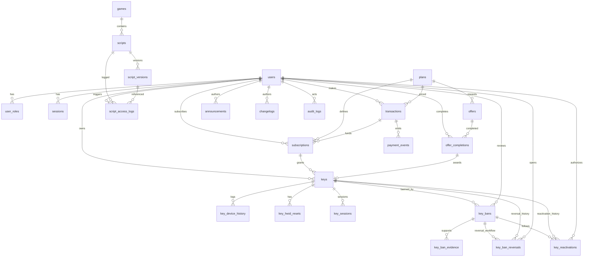
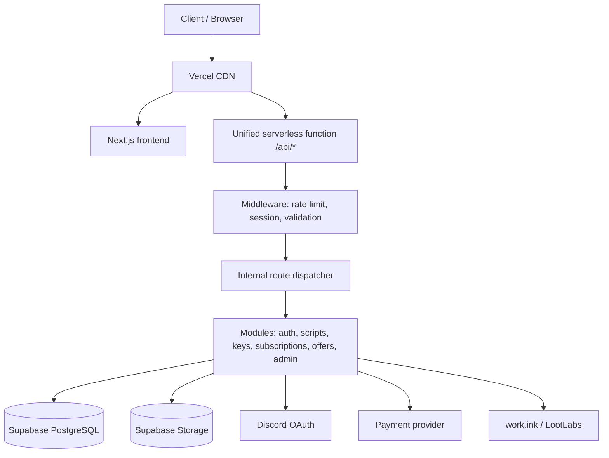
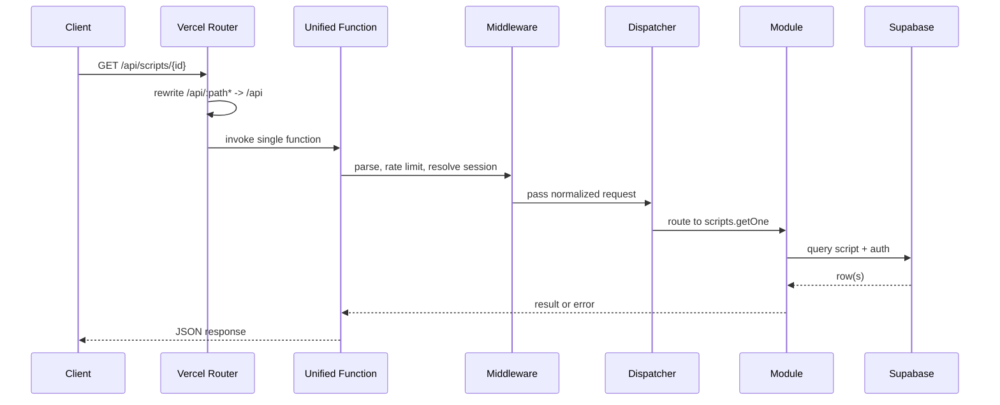
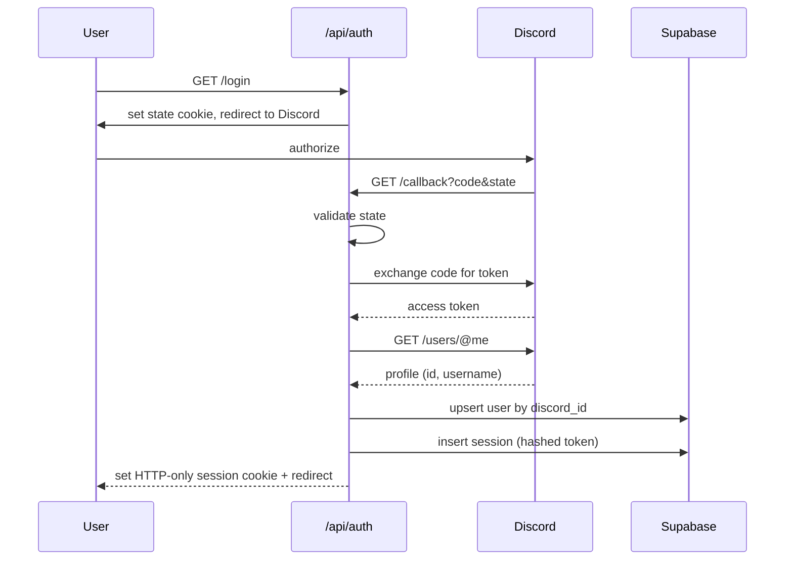
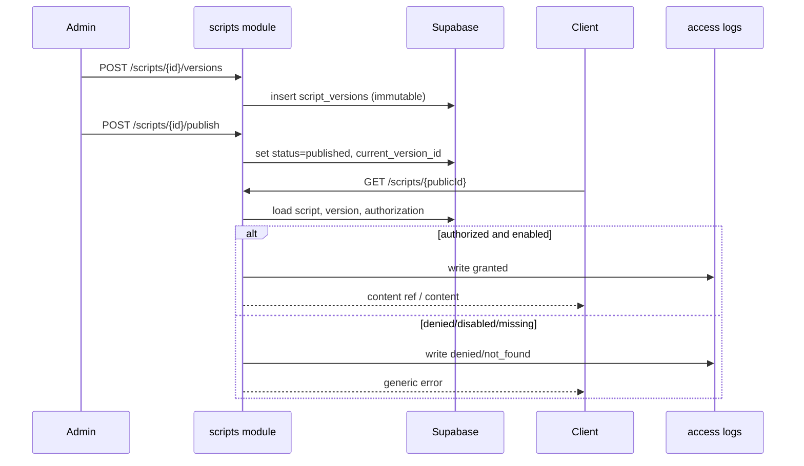
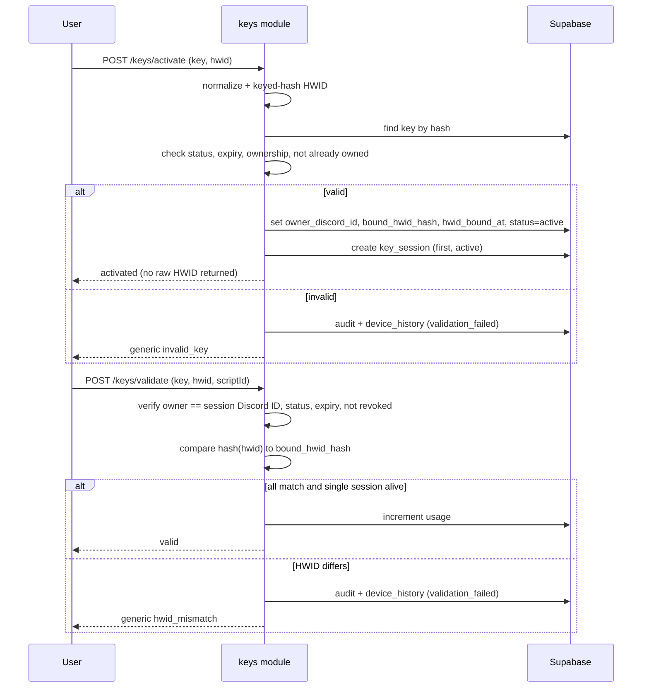
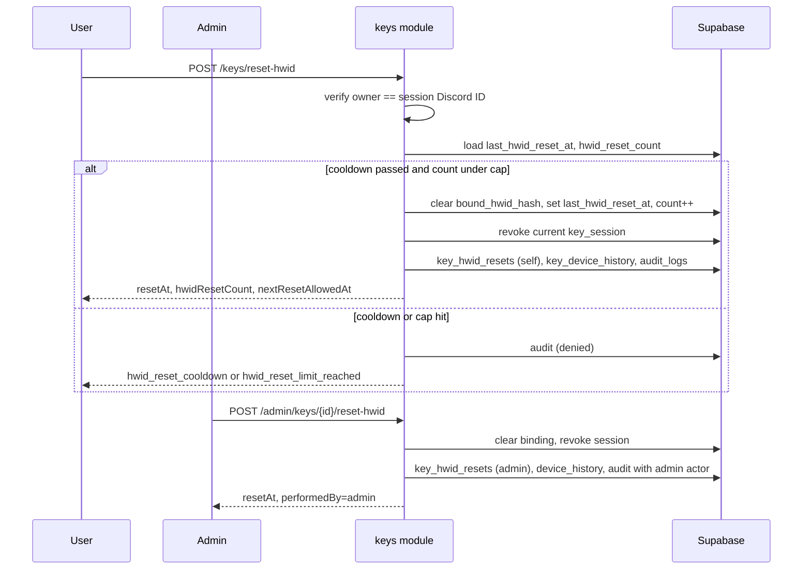
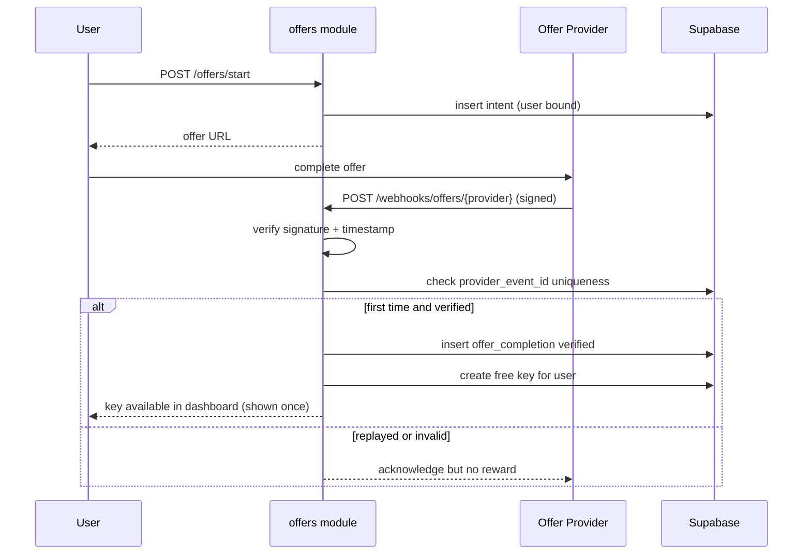

# BOYFINITY Hub - Backend Architecture

**Version:** 1.1
**Status:** Architecture Blueprint (planning only, no implementation)
**Runtime target:** Vercel Hobby, Unified Monolithic Serverless Engine
**Data layer:** Supabase PostgreSQL

> **Documentation status:** READY — DOCUMENTATION COMPLETE
>
> This status means documentation review and consistency work are complete. It does not mean implementation, deployment, or runtime testing are complete.
>
> Sections 8, 9, and 10 have passed their final consistency review.

This document is the implementation blueprint for the BOYFINITY Hub backend. It is a plan, not code. It defines the stack, the routing model, the data model, the API surface, security controls, and a phased roadmap.

Related documents:

- `DESIGN.md` - visual specification (frontend).
- `AGENTS.md` - agent routing rules.

---

## 1. Scope and Non-Goals

### In scope

- Centralized script catalog and authorized distribution API.
- Discord OAuth 2.0 authentication.
- Free and paid key lifecycle.
- Subscription and transaction management.
- Offer (work.ink / LootLabs) completion verification.
- User and admin dashboards (backend contracts).
- Audit logging and security controls.
- Vercel deployment topology and Supabase data model.

### Out of scope (explicit non-goals)

- No executor injection, anti-cheat bypass, or unauthorized game exploitation. The script API only serves games and experiences the project owner is permitted to manage.
- No frontend implementation in this task.
- No real credentials, tokens, or secrets are defined here.
- No changes to existing project files other than this document.

### Confirmed product constraints

- Public pages are browsable without authentication.
- Discord authentication is required to claim free keys, purchase keys, access dashboards, and perform account operations.
- Administrative operations require server-side admin authorization.
- Deployment target is Vercel Hobby with Supabase as the database.

---

## 2. Technology Stack

Each technology is assessed below for purpose, advantages, limitations, and alternatives. No additional infrastructure is introduced without a stated technical justification.

### 2.1 Frontend - Next.js

- **Purpose:** Public landing page, documentation, user dashboard, admin dashboard, marketplace UI.
- **Advantages:** File-based routing, server components, built-in Route Handlers, static generation for public pages, first-class Vercel integration, strong ecosystem.
- **Limitations:** Next.js generates its own build output and Vercel Functions per route. This directly affects the unified-function requirement (see Section 4). It is opinionated about where API code lives.
- **Alternatives:** Remix / React Router (SSR-friendly), Astro (content-heavy public pages), plain React SPA (loses SSR). Next.js is the recommended choice for consistency with the preferred stack and Vercel.

### 2.2 Hosting - Vercel

- **Purpose:** Static hosting, CDN, serverless compute, preview deployments, edge routing.
- **Advantages:** Zero-ops, global CDN, preview deployments per commit, tight Git workflow, generous Hobby allotment.
- **Limitations (Hobby):** See Section 4.8. Key ones: 4.5 MB request/response body limit, 300s max function duration, 2 GB / 1 vCPU per function instance, runtime logs retained only 1 hour, no git-org repositories on Hobby.
- **Alternatives:** Netlify, Cloudflare Workers/Pages (different runtime model), self-hosted VPS (more control, more ops). Vercel is recommended.

### 2.3 Backend API - Node.js Serverless Functions

- **Purpose:** All API logic: auth, scripts, keys, subscriptions, offers, admin.
- **Advantages:** Full Node.js API coverage, large ecosystem, easy Supabase SDK use, streaming support, Fluid compute concurrency reuse.
- **Limitations:** Cold starts (mitigated by Fluid compute instance reuse), statelessness (no in-memory session), 4.5 MB payload cap.
- **Alternatives:** Edge runtime (fast but limited Node APIs, not ideal for DB drivers), a long-lived Node server on a VPS (defeats the unified serverless goal). Node.js runtime on Vercel is recommended.

### 2.4 Database - Supabase PostgreSQL

- **Purpose:** Relational storage for users, scripts, keys, subscriptions, transactions, offers, audit logs.
- **Advantages:** Managed PostgreSQL, Row Level Security, Auth (Discord provider available), Storage, Realtime, auto-generated REST/GraphQL, connection pooler (Supavisor).
- **Limitations:** Direct connections are limited; serverless requires a pooler. RLS is only meaningful when the client role is untrusted; server code using the service role bypasses RLS by design.
- **Alternatives:** Neon (serverless Postgres, branch-based), PlanetScale (MySQL, no FKs), Turso (SQLite/libSQL). Supabase is recommended because it bundles Postgres, RLS, Storage, and Auth in one platform.

### 2.5 Authentication - Discord OAuth 2.0

- **Purpose:** Identify users by immutable Discord user ID.
- **Advantages:** No password storage, strong trusted identity, matches the target audience.
- **Limitations:** External dependency on Discord uptime and rate limits; OAuth flows must be handled server-side for state validation and token exchange.
- **Alternatives:** Supabase Auth with the Discord provider (wraps the same OAuth flow and manages sessions), GitHub OAuth (less aligned with the audience). See Section 5 for the recommended hybrid.

### 2.6 Storage - Supabase Storage

- **Purpose:** Script content blobs, game imagery, avatar cache, downloadable assets.
- **Advantages:** S3-compatible API, integrated auth policies, CDN-backed delivery, RLS-aware.
- **Limitations:** Object storage is not ideal for small frequently-read JSON; keep metadata in Postgres and store only large blobs here.
- **Alternatives:** Cloudflare R2 (cheap egress), Vercel Blob, AWS S3. Supabase Storage is recommended for single-platform simplicity.

### 2.7 Styling - Tailwind CSS

- **Purpose:** Frontend styling tokens aligned with `DESIGN.md`.
- **Advantages:** Utility-first, token-friendly via config, pairs with Next.js.
- **Limitations:** Purely frontend; no backend impact. Listed for stack completeness.
- **Alternatives:** CSS Modules, vanilla-extract. Frontend concern; not elaborated here.

---

## 3. Unified Monolithic Serverless Engine - Design

### 3.1 Architecture requirement

All `/api/*` traffic should reach a single Vercel Serverless Function wherever technically supported, with internal route dispatching. Logical endpoint groups:

- `/api/auth/*`
- `/api/users/*`
- `/api/scripts/*`
- `/api/games/*`
- `/api/keys/*`
- `/api/subscriptions/*`
- `/api/transactions/*`
- `/api/offers/*`
- `/api/admin/*`

A single entry point does **not** mean one giant file. Internal modules stay separated:

```text
BOYFINITY-Hub/
├── api/
│   └── index.js
├── src/
│   ├── modules/
│   │   ├── auth/
│   │   ├── users/
│   │   ├── scripts/
│   │   ├── games/
│   │   ├── keys/
│   │   ├── subscriptions/
│   │   ├── transactions/
│   │   ├── offers/
│   │   └── admin/
│   ├── middleware/
│   ├── services/
│   ├── database/
│   ├── validators/
│   └── utils/
├── public/
├── DESIGN.md
├── AGENTS.md
├── BACKEND.md
└── vercel.json
```

This tree is a target, not a build instruction. No files are created in this task.

### 3.2 Feasibility findings (verified against Vercel conventions)

The following are verified facts, not assumptions.

1. **Can `api/index.js` serve all `/api/*` requests as one function?**
   Yes, but **not automatically for nested paths**. Vercel creates a separate function per source file in the root `api/` directory, and a file at `api/index.js` maps to the `/api` path only. Nested paths such as `/api/auth/login` will not reach it unless rewrites are configured. Vercel's own Node.js runtime documentation recommends exactly this pattern: "Keep related routes in a shared function", define a single fetch handler that "receives requests for all HTTP methods and routes them by URL pathname", and "configure rewrites to send related API paths to the same function".

2. **Correct routing configuration.**
   Add a rewrite that funnels every `/api/*` path into the single entry point. A minimal `vercel.json`:

   ```json
   {
     "$schema": "https://openapi.vercel.sh/vercel.json",
     "rewrites": [
       { "source": "/api/:path*", "destination": "/api" }
     ]
   }
   ```

   The original path must be preserved because the rewrite target is the function itself. Two reliable options:
   - Read the original path from the forwarded request URL or a request header inside the handler.
   - Prefer the explicit form where the handler reconstructs the path from `req.url` / the `x-forwarded-*` headers, and always log it for observability.

   Because a rewrite masks the destination, the handler must not rely on its own URL alone; it should parse the incoming request path. The safest, most portable approach is to dispatch on the request pathname derived from the incoming request, and to keep the rewrite rule as the single funnel.

3. **Do Next.js routing conventions conflict?**
   Yes. This is the single most important routing finding.
   - When a project is detected as **Next.js**, Vercel builds it as a Next.js app. Next.js owns `/api/*` through **Route Handlers** (`app/api/**/route.ts`), and each route handler becomes a Vercel Function unless bundled.
   - A root `api/` directory with hand-written functions is the **non-Next.js convention**. Mixing a root `api/index.js` with a Next.js app is fragile: it can be ignored, double-built, or shadowed by Next.js routing, and it is not the documented pattern.
   - Therefore, for this project, the **reliable unified path depends on whether the deployment is a Next.js app or a plain Node project** (see 3.4).

4. **How should internal dispatch work?**
   The entry point is a thin router. It:
   - Parses method and pathname.
   - Strips the `/api` prefix to get a logical route segment.
   - Matches against a route table whose entries map to module handlers.
   - Runs the middleware chain (auth, rate limit, validation) before the module handler.
   - Returns a normalized response.

   Dispatch is data-driven, not a chain of `if (url === ...)` statements. Example shape (illustrative only, not implemented):

   ```js
   const routes = [
     { method: 'POST', path: '/auth/login',      handler: auth.login,      access: 'public' },
     { method: 'GET',  path: '/scripts/:id',     handler: scripts.getOne,  access: 'public' },
     { method: 'POST', path: '/keys/claim',      handler: keys.claim,      access: 'user' },
     { method: 'POST', path: '/admin/scripts',   handler: admin.createScript, access: 'admin' },
   ];
   ```

5. **How to avoid accidentally generating additional functions.**
   - Keep every module and utility **outside** any recognized function directory (`api/` for the plain Node case, `app/api/` for Next.js). Only the single entry point lives in a function-triggering location.
   - In the plain Node case: exactly one file in `api/`. Every other module is imported from `src/`.
   - In the Next.js case: exactly one catch-all route handler file (`app/api/[...path]/route.ts`) and no other `route.ts` under `app/api/`.
   - Do not add files that Vercel classifies as functions (files directly in `api/`, or `route.ts` files).
   - Verify after deploy by checking the build output's function list.

6. **How modular code is imported into the unified function.**
   The entry point statically imports the module registry: `import { routes } from '../src/router'`, which imports modules, which import services and the database layer. Static imports are required for bundling; dynamic imports with runtime-computed paths can cause the bundler to include whole directories and bloat the bundle (see the 250 MB limit).

7. **Hobby function-count limitation and practical implications.**
   The old hard "12 functions" limit is **no longer listed** for current accounts; the current limits table lists "Functions Created per Deployment" as **framework-dependent** for Hobby and unlimited for Pro. Practical implications:
   - The constraint is no longer a hard function cap on Hobby, but keeping one function is still valuable: Fluid compute **reuses instances across routes within one function**, reducing cold starts and cost.
   - The real Hobby constraints are payload, duration, memory, and log retention (below), not function count.
   - Historical tutorials referencing "12 functions" are outdated; do not design around that number.

8. **Runtime, memory, duration, payload, cold-start limits (Hobby, current).**

   | Limit | Hobby value |
   |---|---|
   | Max memory / CPU | 2 GB / 1 vCPU (default and max) |
   | Max duration | 300s (5 min) default and max |
   | Request/response body | 4.5 MB (413 `FUNCTION_PAYLOAD_TOO_LARGE` beyond) |
   | Bundle size (uncompressed) | 250 MB |
   | File descriptors | 1,024 shared across concurrent executions |
   | Runtime log retention | 1 hour |
   | Regions | Single region (default `iad1`) |
   | Concurrent deployments | 1 |

   Cold starts are mitigated by Fluid compute (concurrent requests reuse a warm instance). Keep the bundle lean and initialize the DB client lazily.

9. **Database connection management with Supabase.**
   - Serverless functions are stateless and scale horizontally; a direct Postgres connection per invocation exhausts connections.
   - Use Supabase's **connection pooler** (Supavisor, transaction mode) via a pooled connection string for server-side queries.
   - Use the **service role key only on the server**, never in the browser. It bypasses RLS, so treat it as a root credential.
   - Initialize one client per function instance (module-scope singleton), not per request.
   - For the Next.js case, prefer the official Supabase SSR helpers and keep the service-role usage confined to server-only modules.

10. **Appropriateness for future growth.**
    Yes. A single function with a data-driven router scales to a large API surface. The real growth risks are bundle size and single-region latency, both addressable (see Section 4.11 migration strategy). The modular structure means splitting later is mechanical.

11. **Migration strategy to multiple functions.**
    - Because modules are independent and the router is data-driven, moving a group (e.g. `/admin/*`) to its own function is a routing change, not a rewrite.
    - Steps: create a new function file, point the relevant rewrite source at it, remove that prefix from the unified router, verify, deploy.
    - Trigger conditions for splitting: bundle size approaching 250 MB, a group needing a longer duration, or a group with very different traffic/scaling needs.
    - Keep the split behind the same public URLs so clients are unaffected.

### 3.3 Recommended routing design

The unified entry point is viable. The recommended, reliable configuration is a **single catch-all router** with **one rewrite rule**, and the entry point dispatches on pathname.

```json
{
  "$schema": "https://openapi.vercel.sh/vercel.json",
  "rewrites": [
    { "source": "/api/:path*", "destination": "/api" }
  ]
}
```

Key rules:

- The rewrite is the only place that knows about the funnel. Module code never re-implements URL routing.
- The handler derives the logical path from the incoming request (pathname minus `/api`).
- Every module is imported from `src/`, never placed in a function directory.
- All responses go through one response helper for consistent error shape and headers.

### 3.4 Deployment-model decision (required trade-off)

The unified function cannot be described without choosing the deployment model, because Next.js and a root `api/` folder do not mix cleanly. Two valid models exist.

**Model A - Next.js app with one catch-all Route Handler (recommended if the frontend is Next.js).**

- Frontend and backend live in one Next.js project.
- The single backend function is `app/api/[...path]/route.ts`.
- It owns all `/api/*` and delegates to `src/` modules.
- No root `api/` directory is used. No `vercel.json` rewrite is needed for internal API routing, because the catch-all route already matches every `/api/*` path.
- Trade-off: the "entry point" is a Next.js Route Handler, not a literal `api/index.js`. This is the idiomatic, supported way to achieve the same goal inside Next.js. It is the most reliable option when the frontend is Next.js.

**Model B - Plain Node project with `api/index.js` (recommended if the frontend is separate or minimal).**

- The backend is a standalone Node project (or a separate deployment) whose only function is `api/index.js`.
- `vercel.json` rewrites funnel `/api/*` into it.
- Trade-off: the frontend is not a Next.js app in this deployment, or lives in a separate project/domain. This matches the literal `api/index.js` requirement.

**Recommendation:** Use **Model B** if the requirement to have a literal `api/index.js` and one function must be met exactly, because it is the only model where `api/index.js` is genuinely the single function. Use **Model A** if a single Next.js project hosting both frontend and backend is preferred; it achieves the same single-function outcome but the entry point is a Route Handler. Do not attempt to combine a root `api/index.js` with a Next.js app; that is the fragile configuration identified in 3.2 item 3.

If the project must be one Next.js app **and** a literal `api/index.js` is non-negotiable, the honest answer is that these two goals conflict, and the requirement should be resolved with the owner (see Section 16).

### 3.5 Avoiding accidental extra functions (checklist)

- [ ] Exactly one function-triggering file exists (plain: `api/index.js`; Next.js: one catch-all `route.ts`).
- [ ] No other files in `api/` (plain model).
- [ ] No other `route.ts` under `app/api/` (Next.js model).
- [ ] All modules, services, validators, and DB code live under `src/`.
- [ ] Imports are static, not dynamically computed paths.
- [ ] Post-build: verify the function list contains exactly the intended function(s).

---

## 4. Discord Authentication

### 4.1 Principles

- Identify users by the **immutable Discord user ID** (the snowflake), never by username or discriminator, which can change.
- **Never request or store Discord passwords.** OAuth only.
- Validate OAuth **state** on every callback.
- Use **HTTP-only, Secure, SameSite** session cookies.
- Session expiration and renewal are server-controlled.
- Roles are verified **server-side** on every privileged request.
- Never trust a client-supplied role, user ID, or session flag.

### 4.2 Authentication flow

1. **Initiate:** `GET /api/auth/login` generates a random, cryptographically strong `state`, stores it in a short-lived HTTP-only cookie (or a `sessions`/`oauth_states` row), then redirects to Discord's authorize URL with the client ID, redirect URI, scopes (`identify`), and `state`.
2. **Consent:** The user authorizes on Discord.
3. **Callback:** `GET /api/auth/callback?code=...&state=...`. The server:
   - Rejects if `state` is missing or does not match the stored value.
   - Exchanges `code` for an access token at Discord's token endpoint, server-side, using the client secret.
   - Fetches the user profile (`/users/@me`) with the access token.
   - Upserts the user by `discord_id`.
   - Creates a session, sets the session cookie, and redirects to the app.
4. **Session:** A session record (or signed token) is stored server-side (see Section 9, `sessions`). The cookie carries only an opaque session identifier.
5. **Logout / revoke:** `POST /api/auth/logout` deletes the session and clears the cookie. `POST /api/auth/logout-all` revokes every session for the user.

### 4.3 Session strategy

- Cookie: HTTP-only, `Secure`, `SameSite=Lax` (or `Strict` if feasible), scoped to the site, with a bounded `Max-Age`.
- Store a **hashed** session token server-side with expiry and rotation metadata.
- **Expiration:** absolute lifetime (e.g. 7–30 days) plus idle timeout.
- **Renewal:** rotate the session token on privilege change and after a fixed interval (sliding window) to limit theft impact.
- **Revocation:** deleting the `sessions` row invalidates the cookie immediately (no client cooperation needed).

### 4.4 Both integration options with Supabase

Two valid approaches:

- **Option 1 - Supabase Auth (Discord provider).** Supabase performs the OAuth exchange and issues its own session; the app verifies the Supabase JWT server-side. Less custom code, built-in refresh, but the session model is Supabase's.
- **Option 2 - Custom Discord OAuth.** The app performs the OAuth exchange and owns the session table. Maximum control, more code to get right.

**Recommendation:** Option 2 (custom) if the platform requires full control over session lifetime, revocation, and audit; Option 1 if time-to-market and less security-critical surface are priorities. Either way, store the Discord user ID on `users.discord_id` and treat it as the identity anchor. Do not rely on Discord tokens as the app session.

### 4.5 Authorization and admin protection

- Roles live in `user_roles` (see Section 9). The set of roles is small and explicit (for example `user`, `moderator`, `admin`).
- Every admin endpoint runs a server-side middleware that: loads the session, loads the user, loads roles from the database, and checks the required role. Client role claims are ignored.
- Administrative endpoints are grouped under `/api/admin/*` and are **never** reachable without an authenticated session with an admin role.
- Sensitive admin actions write an `audit_logs` row (Section 12).

---

## 5. Script Management System

### 5.1 Capabilities (admin)

Create, edit, delete scripts; publish/unpublish; enable/disable; manage versions; assign scripts to games; view access logs.

### 5.2 Script record

| Field | Meaning |
|---|---|
| `id` | Internal database ID (UUID). Never exposed as the primary public handle. |
| `public_id` | Public API identifier (opaque, non-sequential). |
| `name` | Display name. |
| `description` | Human description. |
| `game_id` | Associated game (FK to `games`). |
| `current_version_id` | Points to the active published version. |
| `content_ref` | Script content or storage reference (inline text or Supabase Storage object). |
| `status` | Publication status: `draft`, `published`, `archived`. |
| `enabled` | Boolean kill switch. |
| `created_at`, `updated_at` | Timestamps. |

### 5.3 ID generation

- Internal `id`: database-generated UUID.
- `public_id`: a random, URL-safe, high-entropy string (for example 22+ chars, base62 or base64url) that is unguessable and non-sequential. This prevents enumeration. The public API uses `public_id`, never `id`.
- If a versioned handle is needed, the public identifier can encode script plus version, but the mapping is always resolved server-side.

### 5.4 Publishing and versioning

- Content changes create a new `script_versions` row rather than mutating history.
- **Publishing** sets `scripts.status = published` and `current_version_id` to the chosen version; the previously current version is retained in history.
- **Unpublishing** sets `status` back to `draft` (or `archived`); the public API stops returning the script.
- **Editing** creates a new draft version. Published versions are immutable; corrections produce a new version.
- Version history is queryable by admins; each version records `version_number`, `content_ref`, `changelog`, `created_by`, `created_at`.

### 5.5 Disabled and deleted scripts

- **Disabled** (`enabled = false`): the script still exists but the public API returns `404` (or `403`, see 5.7) and logs the attempt. This is the quick kill switch for incidents.
- **Deleted**: prefer **soft delete** (`deleted_at` timestamp) so audit history and key links survive. Hard delete is reserved for admin-only, fully audited actions. A soft-deleted script is invisible to the public API and to non-admin dashboards.

### 5.6 Retrieval and authorization

- Public endpoint: `GET /api/scripts/{publicId}` returns the currently published, enabled version. Only after the request passes authorization and logging.
- Authorization model: retrieval is gated by a **key**, an **authorized integration**, or an explicit **public/allowlisted** flag on the script.
- The response returns the content reference (or streams the content) only when authorized; unauthorized requests get a generic error, never partial content.

### 5.7 Preventing unauthorized retrieval

- Opaque `public_id`, no sequential IDs, no `id` leakage in payloads.
- One shared error shape for "not found" and "not authorized" so the API does not reveal which scripts exist.
- Rate limiting per IP and per key (Section 12).
- Every successful and failed retrieval writes a `script_access_logs` row: `script_id`, `version_id`, `actor_user_id` (nullable), `key_id` (nullable), `ip`, `user_agent`, `result`, `created_at`.
- Content served from Supabase Storage uses short-lived signed URLs, not permanent public links.

### 5.8 Authorized integrations (scope boundary)

The API supports integrations for games and experiences the project owner is **permitted to manage**. Integrations are registered server-side with their own credentials/scopes. This blueprint does not design executor injection, anti-cheat bypass, or unauthorized modification of third-party games, and no endpoint exists for those purposes.

---

## 6. Key Management

> **FINAL DECISION - Key Ownership & Device Binding.** The rules in this section are final and supersede any earlier, softer wording about key ownership, multi-use keys, or device handling. Where a previous statement conflicts, this section wins.

### 6.1 Capabilities

Generate keys; free and paid types; one-account ownership; activation; expiration; revocation; validation; HWID device binding; HWID reset (self-service and admin); permanent key ban for confirmed sharing violations; subscription association; usage tracking; admin management.

### 6.2 FINAL rules (authoritative)

1. **One owner.** Each key is owned by exactly one Discord account.
2. **Immutable owner identity.** The Discord user ID is the key owner identity and cannot be changed by the user.
3. **Single active device.** Each key may be bound to at most **one active HWID** at any time.
4. **No concurrent multi-device use.** A user may not use the same key simultaneously on multiple devices with different HWIDs.
5. **HWID is device binding, not authentication.** HWID is a binding mechanism layered on top of key plus session auth; it is never the sole proof of identity.
6. **Server-side validation only.** All ownership, status, and HWID checks run on the backend. Client-side validation is never trusted.
7. **Mismatch is denied.** If the presented HWID differs from the bound HWID, the request is rejected with a specific error.
8. **Reset exists.** A user who changes devices or whose device identity changes can reset the bound HWID.
9. **Reset limits.** HWID reset has a configurable cooldown and a configurable maximum number of uses.
10. **Admin powers.** Admins can force a manual HWID reset, revoke a key, ban a key, and view device-change history.
11. **Audit everything.** Activation, HWID validation failures, resets, and key status changes are all written to the audit log.
12. **One active session per key.** At most one active session per key at a time, with a defined expiration and revocation mechanism (Section 6.7).
13. **Key sharing is permanently banned.** Key sharing and unauthorized transfer are strictly prohibited. A confirmed sharing violation results in a **permanent ban** with status `banned` (Section 6.11).

### 6.3 Key model

| Field | Meaning |
|---|---|
| `id` | Internal UUID. |
| `key_hash` | Hash of the key value. The plaintext key is shown once at creation and never stored. |
| `key_prefix` | Short non-secret prefix for display/support. |
| `type` | `free` or `paid`. |
| `status` | `unused`, `active`, `expired`, `revoked`, `suspended`, `banned`. |
| `owner_discord_id` | FINAL: the owning Discord user ID (scope anchor). Immutable once set. |
| `user_id` | Internal FK to `users` for the same owner (mirror of `owner_discord_id`). |
| `bound_hwid_hash` | FINAL: hash of the currently bound HWID (nullable until first activation). |
| `hwid_bound_at` | FINAL: when the current HWID was bound. |
| `last_hwid_reset_at` | FINAL: timestamp of the most recent HWID reset. |
| `hwid_reset_count` | FINAL: number of HWID resets consumed. |
| `banned_at` | FINAL: when the permanent ban was applied (nullable). |
| `ban_reason` | FINAL: violation reason text (nullable). |
| `ban_detected_at` | FINAL: when the violation was detected (nullable). |
| `ban_evidence_refs` | FINAL: jsonb references to evidence (device/session history, logs). |
| `subscription_id` | FK when the key grants a subscription (nullable). |
| `plan_id` | Optional plan link. |
| `max_activations` | Kept for compatibility; a user-owned key binds one account. |
| `activation_count` | Number of activations consumed. |
| `expires_at` | Expiry timestamp (nullable for perpetual, though rare). |
| `created_at`, `updated_at` | Timestamps. |

### 6.4 Generation

- Generate with a cryptographically secure RNG (not `Math.random`).
- Sufficient entropy to resist brute force (for example 128+ bits), formatted in readable groups for the user.
- Store only the **hash** (`key_hash`) plus a display `key_prefix`. The plaintext is returned exactly once in the creation response.
- Guard against duplicate hashes with a unique constraint on `key_hash`.

### 6.5 HWID handling (FINAL)

- **Do not store raw HWID.** Store `bound_hwid_hash` = a keyed hash (HMAC-SHA-256 with a server-only secret, e.g. `HWID_HASH_SECRET`) of the normalized HWID string. This is preferred over a bare hash because a raw HWID may itself be low-entropy and enumerable.
- Normalize before hashing (trim, case-fold, strip vendor formatting) so cosmetic differences do not force resets. The normalization scheme is fixed, documented, and versioned.
- The plaintext HWID is never returned to any client, never logged in full, and never shown to other users or admins (admins see a short non-reversible fingerprint only).
- **Security limitation, stated plainly:** HWID is **not** a forgery-proof identity. It can be spoofed by a determined client, and it changes for legitimate reasons. Treat it as a soft binding and abuse signal, never as proof of identity. See Section 11 for the threat model.

### 6.6 Lifecycle

1. **Generate** (admin or system): key created with `status = unused`, no owner, no bound HWID.
2. **Distribute**: free keys via offer completion; paid keys via transaction completion.
3. **Activate**: the user authenticates, sends the key plus their HWID. The server verifies the key, records `owner_discord_id`/`user_id`, sets `bound_hwid_hash` and `hwid_bound_at`, and sets `status = active`. Rejected if the key is expired, revoked, or already owned by another account.
4. **Use**: each script fetch is validated server-side against key status, owner, expiry, and a matching `bound_hwid_hash`, and against a live single session (Section 6.7).
5. **Expire**: reached `expires_at`, or subscription end; `status = expired`.
6. **Revoke**: admin action; `status = revoked`. Effective immediately, session dropped.
7. **Renew**: for subscription keys, renewal extends `expires_at` and links a new subscription period rather than mutating history.

### 6.7 Single-session-per-key (FINAL)

- A key may have at most **one active session** at a time. Starting a new session supersedes the previous one (the previous becomes inactive) rather than allowing two live sessions.
- **Expiration:** every key session has an absolute `expires_at` and an idle timeout. It is validated on each use; an expired session is rejected and the client must re-authenticate.
- **Revocation:** an admin revoke, an HWID reset, a key status change, or a newer login revokes the current session immediately. Revocation is server-side and needs no client cooperation.
- The key session is distinct from the account/web session in `sessions`; the account session proves who the user is, the key session proves the key is live on one device. Both are required for a script fetch bound to a paid key.

### 6.8 Validation rules

A key-backed request is valid only if all hold (checked server-side):

- The key hash matches a stored key.
- `owner_discord_id` equals the authenticated user's Discord ID.
- `status` is `active` (or the key is `unused` during activation).
- Not past `expires_at`.
- Not revoked or suspended.
- The presented HWID hashes to the stored `bound_hwid_hash`.
- A live key session exists and is not expired or revoked.
- `activation_count < max_activations` where applicable.

Any failure returns a generic external error; the specific reason is logged, not disclosed to the client (prevents oracle attacks). HWID mismatch is logged as a distinct internal event but externally resembles other denials where that does not harm usability.

### 6.9 HWID reset (FINAL)

- A reset clears `bound_hwid_hash`, sets `last_hwid_reset_at = now()`, and increments `hwid_reset_count`. The next valid activation rebinds a new HWID.
- **Cooldown and cap:** between resets there is a configurable cooldown (minimum time since `last_hwid_reset_at`) and a configurable maximum (`hwid_reset_count < max_hwid_resets`). Both limits are admin-configurable per plan or globally via system settings.
- A reset also revokes the current key session, since the device binding changed.
- Admin resets bypass the user cooldown but are still recorded and rate-limited, and can be attributed to an admin actor.
- Every reset (self-service or admin) writes an audit row and a `key_hwid_resets` history row.

### 6.10 Prevention requirements (mapped to controls)

| Threat | Control |
|---|---|
| Unauthorized key reuse | One owner (`owner_discord_id`), immutable once set; server-side ownership check on every request. |
| Invalid key activation | Validate type, status, and expiry before binding; reject already-owned keys. |
| Expired key access | Server-side expiry check on every request. |
| Revoked key access | Status check on every request; revocation drops the session immediately. |
| Client-side authorization bypass | All validation on the server; the client presents a key and HWID, never a verdict. |
| Brute force | Rate limiting on activation and reset attempts plus high key entropy. |
| Key sharing across accounts | Owner binding to the Discord ID plus `bound_hwid_hash`; a different account or device fails. |
| Concurrent multi-device use | Single active HWID plus single active session per key. |
| Reset abuse | Cooldown plus capped `hwid_reset_count`, both admin-configurable; resets are audited and rate-limited. |
| HWID spoofing | Accepted as a residual risk (Section 11); mitigated by combining with account session, single-session enforcement, and anomaly logging, not solved by HWID alone. |

### 6.11 Permanent Key Ban (FINAL)

Key sharing and unauthorized transfer of a key are strictly prohibited. A **confirmed** sharing violation results in a **permanent** ban of that key. The ban is permanent: it is not a cooldown, not a suspension, and it is never lifted automatically.

**Ban state and recorded fields**

- `status = banned` is a terminal key status. It supersedes `active`, `expired`, `revoked`, and `suspended`.
- Recorded at ban time: `banned_at` (ban timestamp), `ban_detected_at` (when the violation was detected, which may precede the ban), `ban_reason` (human-readable violation reason), and `ban_evidence_refs` (references to the supporting records: device history rows, session history, validation-failure logs, access logs).
- The ban is attached to the key row itself, so it survives owner logout, session expiry, and re-authentication.

**Server-side enforcement (no client trust)**

- Every server-side key check treats `status = banned` as a hard deny, evaluated before any other key logic.
- A banned key **cannot** be activated, cannot be validated for script access, and **cannot** reset its HWID. These three operations return a stable generic denial; the internal audit row records the real reason.
- A ban immediately revokes the key's active session and invalidates any outstanding short-lived key token for that key.
- Enforcement lives in the keys module and the shared key guard, not in the frontend. The client can display a ban, but it can never decide or lift one.

**Dashboard indicator**

- A banned key must be shown with a prominent, non-dismissible `BANNED` tag in every place the key appears: the user key list, key detail view, and the admin key table.
- The tag is accompanied by the ban date and a user-facing reason summary. Evidence references are shown to admins only, and never expose raw HWID or another user's data.
- The dashboard must not offer activate, validate, or reset actions for a banned key; the controls are disabled and the backend rejects the call regardless.

**Suspicious activity versus a confirmed violation**

Detection is graded, and an isolated event is never treated as proof:

- **Suspicious (not a ban).** A single HWID mismatch, a device change, a burst of validation failures, or an unusual access pattern raises an anomaly flag and is written to `key_device_history` and `audit_logs`. Legitimate causes exist: hardware replacement, OS reinstall, driver or firmware change, or a changed HWID derivation result. Suspicious activity alone results in observation, rate limiting, and, at most, a review request, not a ban.
- **Confirmed violation (ban).** A ban requires high-confidence evidence of key sharing or transfer. The exact thresholds are admin-configurable, but a confirmation must combine independent signals rather than one field. Examples of acceptable confirmation:
  - The same key is used from multiple distinct device fingerprints in a pattern that cannot be explained by a reset, for example concurrent or rapidly alternating use across devices with no reset in between.
  - The key's owner account and the observed sessions disagree repeatedly with access from geographically or temporally impossible locations.
  - Direct evidence, such as the owner or a third party confirming that the key was handed over, a public or private post distributing the key, or the key being offered for resale.
  - A validation attempt presenting a device fingerprint that matches another account's active session for the same key.
- An isolated HWID mismatch is explicitly **insufficient** for a ban. It is logged as suspicious and handled through the normal reset and session flow.
- **Escalation policy.** Suspicious signal, then anomaly flag and log. Repeated or corroborated signal, then automated retention plus a review queue entry. Review by a moderator against the evidence. Confirmation by an authorized admin, then `status = banned` with reason and evidence refs. No automatable path may ban a key without either a corroborated multi-signal rule set or an explicit admin confirmation.

**Admin review and exceptional reversal**

- Admins can inspect ban evidence at any time: ban reason, detection timestamp, device history, session history, and the audit trail.
- A detected violation can be stored as a **proposal** (`review_status = 'pending_review'`) before it is applied. A proposal is not a ban: the key keeps its current status, sessions, and access. Only an explicit confirm turns it into an applied ban.
- Admins **cannot** silently reactivate a banned key. The ordinary admin UI has no "unban" shortcut.
- Any exceptional reversal must be explicit, require an elevated role, require a written justification, and produce an audit row. A reversal is opened as its own request record (`key_ban_reversals`), limited to one pending request per ban, and approved by an admin other than the requester. The reversal is recorded as a status change from `banned` back to a revived state with the acting admin, the justification, and the original evidence refs retained.
- A reversed key does not inherit its old device binding; it returns to an unbound, re-activation-required state and its reset counters are preserved for review.
- Every ban, denial against a banned key, and reversal is audited (Section 6.2 rule 11).

---

## 7. Monetization and Offers

### 7.1 Capabilities

Free key claiming; work.ink and LootLabs offer integration; monthly, 3-month, and 6-month subscriptions; transaction history; payment verification; subscription expiration and renewal.

### 7.2 Subscriptions

- Plans are rows in `plans` (see Section 9) with duration and price metadata. Durations: monthly, 3-month, 6-month.
- A subscription is a row in `subscriptions` linking `user_id`, `plan_id`, `status`, `started_at`, `expires_at`, and the originating `transaction_id`.
- **Expiration:** reached `expires_at`; a scheduled job or lazy check flips status to `expired`.
- **Renewal:** a new payment creates a new subscription period; the previous period is preserved. Stacking extends `expires_at`.

### 7.3 Free key claiming

1. User is authenticated.
2. User starts an offer; the platform returns an offer URL from work.ink or LootLabs.
3. User completes the offer on the provider.
4. Provider sends a **server-to-server callback** to our endpoint.
5. The server verifies the callback (see 7.4), records an `offer_completions` row, and issues a free key to the user.
6. The key is returned to the user (shown once) and logged.

**The browser redirect back to our site is never proof of completion.** Only the verified server callback releases a key.

### 7.4 Offer callback verification

- Verify the provider's signature or shared-secret hash on the raw request body.
- Check the callback timestamp against a tolerance window to reject stale requests.
- Enforce **idempotency** with a unique constraint on `(provider, provider_event_id)` so a replayed callback cannot issue a second key.
- Confirm the claimed offer matches the user and the expected reward before issuing anything.
- Reject any callback whose signature cannot be verified; log the attempt.
- Do not trust any parameter that the client could set (user id in the URL, redirect query, etc.). The user identity must come from the signed callback payload or from a stored, pre-created offer session tied to that user.
- Since a callback arrives before or without a browser session, bind the offer to the user at **offer start** (store an `offers`/`offer_completions` intent row keyed by a signed token), then match it on callback.

### 7.5 Payments

- **Never rely exclusively on client-side payment status.** A client saying "paid" is not proof.
- Provider-independent architecture: an abstract `PaymentVerifier` interface with one implementation per provider. The rest of the system depends only on the interface.
- Provider secrets stay **server-side** in environment variables (Section 13). Never sent to the browser.
- Payment confirmation arrives as a signed server callback (webhook). The server verifies the signature, records a `payment_events` row, and only then marks the transaction `paid` and grants the key/subscription.
- Reconciliation: a periodic job can query the provider's API for pending transactions as a backstop, so a missed webhook does not lose a payment.
- **Do not invent credentials.** No provider is assumed configured; the architecture defines the contract, and the owner supplies real keys at deployment time.

---

## 8. Database Architecture

### 8.1 Conventions

- PostgreSQL (Supabase). UUID primary keys (`gen_random_uuid()`), `timestamptz` timestamps defaulting to `now()`.
- `snake_case` names. Soft delete via `deleted_at` where history matters.
- Money stored as integer minor units (for example cents) plus a currency code, never as floating point.
- All tables have `created_at`; mutable tables also have `updated_at`.

### 8.2 Tables

**users**

| Column | Type | Notes |
|---|---|---|
| id | uuid | PK |
| discord_id | text | Unique, not null (identity anchor) |
| username | text | Display only, mutable |
| avatar_url | text | Nullable |
| email | text | Nullable, only if scope granted |
| status | text | `active`, `suspended`, `deleted` |
| created_at / updated_at | timestamptz | |

- Unique: `discord_id`. Index: `status`.

**user_roles**

| Column | Type | Notes |
|---|---|---|
| id | uuid | PK |
| user_id | uuid | FK users(id), on delete cascade |
| role | text | `user`, `moderator`, `admin` |
| granted_by | uuid | Nullable FK users(id) |
| created_at | timestamptz | |

- Unique: `(user_id, role)`. Index: `user_id`.

**games**

| Column | Type | Notes |
|---|---|---|
| id | uuid | PK |
| name | text | Not null |
| slug | text | Unique |
| description | text | Nullable |
| image_url | text | Nullable |
| created_at / updated_at | timestamptz | |

- Unique: `slug`.

**scripts**

| Column | Type | Notes |
|---|---|---|
| id | uuid | PK |
| public_id | text | Unique, opaque |
| name | text | Not null |
| description | text | Nullable |
| game_id | uuid | FK games(id) |
| current_version_id | uuid | FK script_versions(id), nullable |
| content_ref | text | Inline or storage reference |
| status | text | `draft`, `published`, `archived` |
| enabled | boolean | Default true |
| created_by | uuid | FK users(id) |
| deleted_at | timestamptz | Nullable (soft delete) |
| created_at / updated_at | timestamptz | |

- Unique: `public_id`. Indexes: `game_id`, `status`, `enabled`.

**script_versions**

| Column | Type | Notes |
|---|---|---|
| id | uuid | PK |
| script_id | uuid | FK scripts(id), on delete cascade |
| version_number | integer | Monotonic per script |
| content_ref | text | Immutable content |
| changelog | text | Nullable |
| created_by | uuid | FK users(id) |
| created_at | timestamptz | |

- Unique: `(script_id, version_number)`.

**script_access_logs**

| Column | Type | Notes |
|---|---|---|
| id | uuid | PK |
| script_id | uuid | FK scripts(id) |
| version_id | uuid | Nullable FK script_versions(id) |
| actor_user_id | uuid | Nullable FK users(id) |
| key_id | uuid | Nullable FK keys(id) |
| ip | text | Nullable |
| user_agent | text | Nullable |
| result | text | `granted`, `denied`, `not_found` |
| created_at | timestamptz | |

- Indexes: `script_id`, `created_at` (partition/retention candidate).

**plans**

| Column | Type | Notes |
|---|---|---|
| id | uuid | PK |
| code | text | Unique (`monthly`, `3month`, `6month`) |
| name | text | Not null |
| duration_days | integer | Not null |
| price_minor | integer | Minor units |
| currency | text | ISO code |
| active | boolean | Default true |
| created_at / updated_at | timestamptz | |

- Unique: `code`.

**keys**

| Column | Type | Notes |
|---|---|---|
| id | uuid | PK |
| key_hash | text | Unique, not null |
| key_prefix | text | Display only |
| type | text | `free`, `paid` |
| status | text | `unused`, `active`, `expired`, `revoked`, `suspended`, `banned` |
| owner_discord_id | text | FINAL: owning Discord user ID; immutable once set; nullable before activation |
| user_id | uuid | Nullable FK users(id); mirrors `owner_discord_id` |
| bound_hwid_hash | text | FINAL: keyed hash of the bound HWID; nullable until first activation |
| hwid_bound_at | timestamptz | FINAL: when the current HWID was bound |
| last_hwid_reset_at | timestamptz | FINAL: timestamp of the most recent reset |
| hwid_reset_count | integer | FINAL: resets consumed; default 0 |
| banned_at | timestamptz | FINAL: when the permanent ban took effect; nullable |
| ban_detected_at | timestamptz | FINAL: when the sharing violation was detected (may precede `banned_at`); nullable |
| ban_reason | text | FINAL: violation reason summary; nullable |
| ban_evidence_refs | jsonb | FINAL: denormalized snapshot of evidence references for fast display; authoritative detail lives in `key_ban_evidence`; nullable |
| subscription_id | uuid | Nullable FK subscriptions(id) |
| plan_id | uuid | Nullable FK plans(id) |
| max_activations | integer | Default 1 |
| activation_count | integer | Default 0 |
| expires_at | timestamptz | Nullable |
| created_at / updated_at | timestamptz | |

- Unique: `key_hash`. Indexes: `user_id`, `owner_discord_id`, `status`, `bound_hwid_hash` (non-unique; for anomaly queries), partial index on `banned_at` where `status = 'banned'`.
- Constraint: `owner_discord_id` and `user_id` are set together at activation and are not changed afterward.
- Constraint: at most one active key session per key is enforced via `key_sessions` (below), not on this row directly.
- CHECK: `status` is restricted to the six enumerated values, so a banned key is a distinct state and never satisfies `status = 'active'`.
- CHECK: a banned key must carry a ban timestamp: `CHECK (status <> 'banned' OR banned_at IS NOT NULL)`.
- Denormalization rule: the four `ban_*` columns mirror the current `key_bans` row for cheap enforcement and display. `key_bans` and `key_ban_evidence` are authoritative; the mirrored columns are written in the same transaction and must never be updated independently.
- Proposal rule: the `ban_*` columns are populated only when a ban is **applied** (`review_status = 'confirmed'`). A `pending_review` proposal lives only in `key_bans` and leaves all four columns NULL, so `keys` alone never implies enforcement for a merely proposed ban.
- Retention rule: the `ban_*` columns are **not** cleared on exceptional reversal. `banned_at` and `ban_reason` remain as history while `status` moves off `banned`; the authoritative record is the `key_bans` row with `review_status = 'reversed'`.
- Reactivation rule: a key that is `suspended` because of a reversal is activated again only after an unconsumed `key_reactivations` authorization exists. The owner then completes the normal activation flow, which consumes that authorization.

**key_bans** (FINAL: permanent key ban record)

| Column | Type | Notes |
|---|---|---|
| id | uuid | PK |
| key_id | uuid | FK keys(id), on delete restrict |
| reason | text | Not null; violation reason (full internal wording) |
| detected_at | timestamptz | Not null; when the sharing signal was detected |
| banned_at | timestamptz | Nullable; set only when the ban is **applied** (`review_status = 'confirmed'`). Stays NULL on a proposal |
| detection_category | text | `multi_device_pattern`, `concurrent_sessions`, `impossible_travel`, `third_party_report`, `resale_listing`, `owner_admission`, `other` |
| confidence | text | `high`, `confirmed`; only bannable grades are stored here |
| reviewed_by | uuid | Nullable FK users(id); admin who confirmed or rejected the row |
| review_status | text | `pending_review`, `confirmed`, `rejected`, `reversed`; see the lifecycle below |
| reversed_at | timestamptz | Nullable; set only on exceptional reversal |
| reversed_by | uuid | Nullable FK users(id); elevated admin who authorized the reversal |
| reversal_reason | text | Nullable; written justification, required on reversal |
| created_at / updated_at | timestamptz | |

- Indexes: `key_id`, `banned_at`, `review_status`, `confidence`.
- Partial unique index: at most one **live** row per key, `UNIQUE (key_id) WHERE review_status IN ('pending_review', 'confirmed')`. Rejected and reversed rows stay as history, so a later proposal or re-ban is a new row, never an overwrite.
- CHECK: `confidence` is restricted to `high` and `confirmed`. Suspicious-but-unconfirmed activity is **not** stored here; it belongs in `key_device_history` and `audit_logs`. This keeps an isolated HWID mismatch out of the ban table entirely.
- CHECK: reversal fields are all-or-nothing: `CHECK (review_status <> 'reversed' OR (reversed_at IS NOT NULL AND reversed_by IS NOT NULL AND reversal_reason IS NOT NULL))`.
- CHECK: an applied ban must carry the moment it took effect: `CHECK (review_status NOT IN ('confirmed', 'reversed') OR banned_at IS NOT NULL)`.
- Deletion: `ON DELETE RESTRICT` from `keys`; ban rows are never hard-deleted. Reversal is a column update, never a row removal.

**Proposal versus applied ban (FINAL separation)**

`key_bans` stores two different things, and the `review_status` value is what separates them. Code must branch on the status, never on the mere existence of a row.

| `review_status` | Meaning | `keys.status` | Enforcement | Sessions |
|---|---|---|---|---|
| `pending_review` | Proposal only. Not verified, not applied | Unchanged (`active`, `expired`, etc.) | None. Validation, activation, and HWID reset behave exactly as before | Untouched |
| `confirmed` | Violation verified and ban applied | `banned` | Immediate and permanent deny | Revoked in the same transaction |
| `rejected` | Proposal closed without a ban | Unchanged | None | Untouched |
| `reversed` | Applied ban exceptionally cancelled | `suspended`, binding cleared | Deny via `suspended` until admin-authorized reactivation | Revoked |

- A `pending_review` row **must not** set `keys.banned_at`, `keys.ban_detected_at`, `keys.ban_reason`, or `keys.ban_evidence_refs`, and must not revoke sessions. A pending proposal that blocks a key would contradict this contract.
- Only the `pending_review` to `confirmed` transition enforces a ban. It sets `banned_at` and the mirrored `keys` columns and revokes sessions in one transaction.
- `rejected` and `reversed` are terminal for that row. Neither is deleted, so the review history stays auditable.
- `confidence` may be `high` on a proposal, but a proposal never enforces anything until an authorized admin confirms it.

**key_ban_evidence**

| Column | Type | Notes |
|---|---|---|
| id | uuid | PK |
| ban_id | uuid | FK key_bans(id), on delete restrict |
| evidence_type | text | `device_history`, `session_history`, `validation_failure`, `access_log`, `external_report`, `admin_note` |
| source_table | text | Nullable; referenced table name (`key_device_history`, `key_sessions`, `audit_logs`, `script_access_logs`) |
| source_id | uuid | Nullable; PK of the referenced row |
| hwid_fingerprint | text | Nullable; short non-reversible fingerprint only |
| summary | text | Nullable; short description of what the reference proves |
| metadata | jsonb | Nullable; contextual notes |
| created_by | uuid | Nullable FK users(id) |
| created_at | timestamptz | |

- Indexes: `ban_id`, `evidence_type`, `(source_table, source_id)`.
- Reference integrity: `source_table`/`source_id` form a polymorphic reference across several tables, so no single FK can be declared. Both are nullable and set together: `CHECK ((source_table IS NULL) = (source_id IS NULL))`. Referential validity is enforced by the writing module, not the database.
- **Sensitive-data constraint (FINAL):** raw HWID, full device identifiers, session tokens, and any secret must never be stored in this table. `hwid_fingerprint` holds only the short non-reversible display fingerprint already used in `key_device_history`, and `metadata` is constrained by policy to the same rule. Evidence proves a pattern; it does not archive the device identity.
- Deletion: `ON DELETE RESTRICT`; evidence is append-only and survives a reversal so the original justification remains reviewable.

**key_ban_reversals** (FINAL: reversal workflow record)

`audit_logs` answers who did what and when. It is not a workflow store, so reversal requests get their own row, which also allows a uniqueness rule of one open request per ban.

The **key owner** opens the request from the dashboard. `requested_by` is taken from the authenticated server session, never from the request body. An admin reviews the request and approves or rejects it.

| Column | Type | Notes |
|---|---|---|
| id | uuid | PK |
| ban_id | uuid | FK key_bans(id), on delete restrict |
| key_id | uuid | FK keys(id), on delete restrict; denormalized for querying the key's history without a join to the ban |
| requested_by | uuid | FK users(id); the authenticated requester (the key owner); server session only |
| justification | text | Not null; why the owner believes the ban is wrong |
| status | text | `pending_approval`, `approved`, `rejected`, `cancelled`; default `pending_approval` |
| decided_by | uuid | Nullable FK users(id); the admin who approved or rejected |
| decided_at | timestamptz | Nullable; set with `decided_by` |
| decision_reason | text | Nullable; required on `approved` and `rejected` |
| cancelled_at | timestamptz | Nullable; set only on `cancelled` |
| created_at / updated_at | timestamptz | |

- Indexes: `ban_id`, `key_id`, `requested_by`, `created_at`; partial index on `status` where `status = 'pending_approval'` for the review queue.
- Partial unique index: at most one open request per ban, `UNIQUE (ban_id) WHERE status = 'pending_approval'`. A new request can only be opened after the previous one reaches `approved`, `rejected`, or `cancelled`. A key that is reversed and later banned again gets a new `key_bans` row and therefore its own request slot.
- CHECK: `status` is restricted to the four enumerated values.
- CHECK lifecycle: `pending_approval` requires `decided_by`, `decided_at`, `decision_reason`, and `cancelled_at` to be NULL. `approved` and `rejected` require `decided_by`, `decided_at`, and `decision_reason`, and require `cancelled_at` to be NULL. `cancelled` requires `decided_by`, `decided_at`, and `decision_reason` to be NULL and `cancelled_at` to be NOT NULL.
- CHECK: no self-approval, enforced in the database as well as the API: `CHECK (decided_by IS NULL OR decided_by <> requested_by)`. A requester who wants out cancels; they never decide their own request.
- Cancellation rule: only `requested_by` may cancel, and only while `status = 'pending_approval'`. The identity check runs server-side against the session actor, so the permission alone is insufficient. Cancelling frees the partial unique slot.
- Cross-table rule: a request may reference only a ban whose `review_status = 'confirmed'`. The database cannot express this with a CHECK, so the application enforces it and the audit row records the attempt.
- Only `approved` changes the ban. In one transaction the approving admin sets the request to `approved` with `decided_by`, `decided_at`, `decision_reason`; sets `key_bans.review_status = 'reversed'`, `reversed_at`, `reversed_by`, `reversal_reason`; clears `keys.bound_hwid_hash`; sets `keys.status = 'suspended'`; revokes sessions; writes `key_device_history` (`ban_reversed`); and writes the audit rows. `reversed_by` is copied from `decided_by` and `reversal_reason` from `decision_reason`, so the ban row and the request cannot disagree. `pending_approval`, `rejected`, and `cancelled` leave the ban fully enforced.
- Reversal never activates a key. Approval ends at `suspended` with an empty binding. Reactivation requires the separate `key_reactivations` authorization below.
- Concurrency: request creation relies on the partial unique index, and a violation maps to the existing `reversal_pending` conflict. Approval, rejection, and cancellation each run as a conditional update on `status = 'pending_approval'`. The decision transaction also locks the `key_bans` row and re-checks `review_status = 'confirmed'` before writing. Zero affected rows means the request already left `pending_approval` and returns the existing `invalid_transition` conflict. Lock order is `key_bans`, then `key_ban_reversals`, then `keys`, then `key_sessions`, always in that order, so concurrent decisions cannot deadlock or produce two terminal states.
- Atomicity: the approval transaction covers the request, the ban row, the key row, session revocation, device history, and the audit row. A partial success is impossible.
- Idempotency: a repeated request with the same `Idempotency-Key` returns the stored response. A repeated decision on a terminal row returns the current state with no further side effects.
- Deletion: `ON DELETE RESTRICT`; rows are append-only, so cancelled, rejected, and approved requests remain visible as history. No terminal state is ever hard-deleted.
- Authority split: this table is authoritative for the **workflow** (who asked, who decided, what state the request is in); `key_bans` is authoritative for the **ban state**. The approval transaction writes both, so they cannot diverge.
- **Reconciliation pending outside this section:** Sections 9 and 10 still describe the open and cancel calls as admin actions with `key.ban.reversal`. Under the owner-initiated model recorded here, those authorization labels need revision. This table needs no change for that revision.

**key_reactivations** (FINAL: admin-authorized reactivation history)

A reversal ends at `suspended`, never at `active`. Reactivation requires a separate admin authorization, recorded here, and only then may the owner complete the normal activation flow.

| Column | Type | Notes |
|---|---|---|
| id | uuid | PK |
| key_id | uuid | FK keys(id), on delete restrict |
| ban_id | uuid | FK key_bans(id), on delete restrict; the reversed ban this authorization follows |
| authorized_by | uuid | FK users(id); the admin who authorized reactivation |
| reason | text | Not null; written justification |
| authorized_at | timestamptz | Not null, default `now()` |
| consumed_at | timestamptz | Nullable; set when the owner completes activation |
| created_at | timestamptz | |

- Indexes: `key_id`, `ban_id`, `authorized_by`, `authorized_at`.
- Partial unique index: at most one unused authorization per key, `UNIQUE (key_id) WHERE consumed_at IS NULL`.
- CHECK: an authorization cannot be consumed before it was granted: `CHECK (consumed_at IS NULL OR consumed_at >= authorized_at)`.
- Cross-table rule: the referenced ban must be `review_status = 'reversed'` for this key. The application enforces it and the audit row records a rejected attempt.
- Activation rule: an owner activation of a key that is `suspended` after a reversal requires an unconsumed authorization for that key. The activation transaction consumes it (`consumed_at = now()`) in the same transaction that binds the new device, issues the key session, and writes the audit rows. Reversal approval alone never satisfies this rule.
- Rejecting or cancelling a reversal never creates an authorization.
- Deletion: `ON DELETE RESTRICT`; rows are append-only, so reactivation history survives later bans.

**Ban enforcement invariants (database level)**

- `status` is one mutually exclusive column, and `banned` is in the allowed set, so a banned key cannot simultaneously be `active` in any status predicate.
- All read paths must test `status = 'active'` (positive test) and must never use a bare negative such as `status <> 'revoked'`, which would wrongly admit `banned`.
- A **proposal** is written in one transaction as a `key_bans` row with `review_status = 'pending_review'` plus its `key_ban_evidence` rows and an audit row. It changes nothing else: no `keys.status`, no `banned_at`, no session revocation. Rejecting it sets `review_status = 'rejected'` and writes an audit row.
- An **applied** ban is written in a single transaction: insert or confirm `key_bans` (`review_status = 'confirmed'`, `banned_at`), set `keys.status = 'banned'`, `banned_at`, `ban_detected_at`, `ban_reason`, `ban_evidence_refs`, revoke any `key_sessions` row for the key (`status = 'revoked'`, `revoked_at = now()`), and insert the `audit_logs` rows.
- Activation, validation, and HWID reset guards must all include a `status <> 'banned'` (or positive `status = 'active'`) condition. This guard reads `keys.status`, never the existence of a `key_bans` row, so a pending or rejected proposal cannot block anything.
- The database rejects a `confirmed` or `reversed` ban row that omits `banned_at`; a `pending_review` row must leave it NULL.
- Recommended backstop (documentation only, no migration in this phase): a trigger rejecting an `active` `key_sessions` row whose `keys.status = 'banned'`.
- A **reversal approval** is atomic with the ban transition and stops at `suspended`. It never sets `status = 'active'` and never creates a reactivation authorization.
- Reactivation is a two-step path: an admin writes a `key_reactivations` row, then the owner activation consumes it. No operation moves a key from `banned` directly to `active`.
- History retention: `key_bans`, `key_ban_evidence`, `key_ban_reversals`, `key_reactivations`, `key_device_history`, and `audit_logs` are append-only for their lifecycle. Reversal and reactivation change state, never remove rows.

**key_device_history**

| Column | Type | Notes |
|---|---|---|
| id | uuid | PK |
| key_id | uuid | FK keys(id), on delete cascade |
| event | text | `bound`, `validation_failed`, `reset_self`, `reset_admin`, `revoked`, `banned`, `ban_reversed` |
| hwid_fingerprint | text | Short non-reversible display fingerprint; never the raw HWID |
| actor_user_id | uuid | Nullable FK users(id) (null for system/device events) |
| actor_admin_id | uuid | Nullable FK users(id) (set for admin actions) |
| ip | text | Nullable |
| metadata | jsonb | Nullable (reason, cooldown state, etc.; never raw HWID) |
| created_at | timestamptz | |

- Indexes: `key_id`, `created_at`. This is the device-change history admins can view.
- Suspicious detections are recorded here as `validation_failed` with context in `metadata`; a confirmed ban is referred to `key_bans` + `key_ban_evidence` and mirrored here, not duplicated verbatim.

**key_hwid_resets**

| Column | Type | Notes |
|---|---|---|
| id | uuid | PK |
| key_id | uuid | FK keys(id), on delete cascade |
| user_id | uuid | Nullable FK users(id) (owner at time of reset) |
| performed_by | text | `self` or `admin` |
| admin_id | uuid | Nullable FK users(id) when performed by an admin |
| previous_hwid_fingerprint | text | Display fingerprint of the replaced binding |
| new_hwid_fingerprint | text | Nullable; set when a new HWID is bound next |
| reason | text | Nullable |
| created_at | timestamptz | |

- Indexes: `key_id`, `user_id`, `created_at`.

**key_sessions** (FINAL: single-session-per-key enforcement)

| Column | Type | Notes |
|---|---|---|
| id | uuid | PK |
| key_id | uuid | FK keys(id), on delete cascade |
| user_id | uuid | FK users(id) |
| session_token_hash | text | Unique; opaque token hashed at rest |
| hwid_fingerprint | text | Display fingerprint of the device for this session |
| status | text | `active`, `superseded`, `expired`, `revoked` |
| expires_at | timestamptz | Not null (absolute lifetime) |
| last_seen_at | timestamptz | Nullable (idle timeout basis) |
| revoked_at | timestamptz | Nullable |
| created_at | timestamptz | |

- Unique: `session_token_hash`.
- Partial unique index: at most one `status = 'active'` row per `key_id` (e.g. `UNIQUE (key_id) WHERE status = 'active'`).
- Indexes: `key_id`, `user_id`, `expires_at`.

**system_settings**

| Column | Type | Notes |
|---|---|---|
| id | uuid | PK |
| key | text | Unique setting name (e.g. `hwid.reset_cooldown_hours`) |
| value | jsonb | Setting value |
| updated_by | uuid | Nullable FK users(id) |
| created_at / updated_at | timestamptz | |

- Unique: `key`. Holds admin-configurable limits such as HWID reset cooldown and maximum resets.

**subscriptions**

| Column | Type | Notes |
|---|---|---|
| id | uuid | PK |
| user_id | uuid | FK users(id) |
| plan_id | uuid | FK plans(id) |
| transaction_id | uuid | Nullable FK transactions(id) |
| status | text | `pending`, `active`, `expired`, `cancelled` |
| started_at | timestamptz | Nullable |
| expires_at | timestamptz | Nullable |
| created_at / updated_at | timestamptz | |

- Indexes: `user_id`, `status`, `expires_at`.

**transactions**

| Column | Type | Notes |
|---|---|---|
| id | uuid | PK |
| user_id | uuid | FK users(id) |
| plan_id | uuid | Nullable FK plans(id) |
| provider | text | Payment provider id |
| provider_txn_id | text | Unique per provider when present |
| amount_minor | integer | Minor units |
| currency | text | ISO code |
| status | text | `pending`, `paid`, `failed`, `refunded` |
| created_at / updated_at | timestamptz | |

- Unique: `(provider, provider_txn_id)`. Index: `user_id`, `status`.

**payment_events**

| Column | Type | Notes |
|---|---|---|
| id | uuid | PK |
| provider | text | Provider id |
| provider_event_id | text | Provider event id |
| transaction_id | uuid | Nullable FK transactions(id) |
| raw_payload | jsonb | Stored for audit |
| signature_valid | boolean | Verification result |
| processed_at | timestamptz | Nullable |
| created_at | timestamptz | |

- Unique: `(provider, provider_event_id)` (idempotency).

**offers**

| Column | Type | Notes |
|---|---|---|
| id | uuid | PK |
| provider | text | `workink`, `lootlabs` |
| code | text | Internal offer code |
| reward_plan_id | uuid | Nullable FK plans(id) |
| reward_key_type | text | e.g. `free` |
| active | boolean | Default true |
| created_at / updated_at | timestamptz | |

- Unique: `(provider, code)`.

**offer_completions**

| Column | Type | Notes |
|---|---|---|
| id | uuid | PK |
| offer_id | uuid | FK offers(id) |
| user_id | uuid | FK users(id) |
| provider_event_id | text | Provider callback id |
| status | text | `pending`, `verified`, `rejected`, `rewarded` |
| reward_key_id | uuid | Nullable FK keys(id) |
| verified_at | timestamptz | Nullable |
| created_at | timestamptz | |

- Unique: `(provider_event_id)` for replay protection. Indexes: `user_id`, `status`.

**announcements**

| Column | Type | Notes |
|---|---|---|
| id | uuid | PK |
| title | text | Not null |
| body | text | Not null |
| published | boolean | Default false |
| published_at | timestamptz | Nullable |
| created_by | uuid | FK users(id) |
| created_at / updated_at | timestamptz | |

**changelogs**

| Column | Type | Notes |
|---|---|---|
| id | uuid | PK |
| version | text | Not null |
| title | text | Not null |
| body | text | Not null |
| published | boolean | Default false |
| published_at | timestamptz | Nullable |
| created_by | uuid | FK users(id) |
| created_at / updated_at | timestamptz | |

**audit_logs**

| Column | Type | Notes |
|---|---|---|
| id | uuid | PK |
| actor_user_id | uuid | Nullable FK users(id) |
| action | text | e.g. `script.publish`, `key.revoke`, `key.activate`, `key.hwid_validation_failed`, `key.hwid_reset_self`, `key.hwid_reset_admin`, `key.status_change`, `key.ban_proposed`, `key.ban_applied`, `key.ban_rejected`, `key.ban`, `key.ban_denied`, `key.ban_reversal_requested`, `key.ban_reversal`, `key.ban_reversal_rejected`, `key.ban_reversal_cancelled`, `key.ban_reactivation_authorized`, `key.ban_reactivation_consumed` |
| target_type | text | Nullable |
| target_id | text | Nullable |
| metadata | jsonb | Nullable (never raw HWID) |
| ip | text | Nullable |
| created_at | timestamptz | |

- Indexes: `actor_user_id`, `action`, `created_at`.
- FINAL: key activation, HWID validation failures, HWID resets, and key status changes must all produce an audit row (Section 6.2 rule 11). Each ban, each denial against a banned key, and each exceptional reversal also produce an audit row (Section 6.11).
- Reversal and reactivation audit rule: every request, cancellation, approval, rejection, reactivation authorization, and reactivation consumption writes an audit row with actor, target id, timestamp, and the relevant reason. Audit rows are independent of the workflow rows, so they remain readable when a request or key changes status, and they are never deleted with the rows they describe.

**sessions** (required if the custom OAuth session strategy is used)

| Column | Type | Notes |
|---|---|---|
| id | uuid | PK |
| user_id | uuid | FK users(id), on delete cascade |
| token_hash | text | Unique, not null |
| user_agent | text | Nullable |
| ip | text | Nullable |
| expires_at | timestamptz | Not null |
| revoked_at | timestamptz | Nullable |
| created_at | timestamptz | |

- Unique: `token_hash`. Index: `user_id`, `expires_at`.

### 8.3 Entity relationship diagram



**Ban table relationship summary**

| Child | Parent | Column | On delete | Rationale |
|---|---|---|---|---|
| key_bans | keys | key_id | RESTRICT | A key with ban history cannot be hard-deleted; keys use soft delete anyway. |
| key_ban_evidence | key_bans | ban_id | RESTRICT | Evidence is append-only and must outlive the ban's review state. |
| key_ban_reversals | key_bans | ban_id | RESTRICT | The reversal workflow record must survive rejection, cancellation, and approval. |
| key_ban_reversals | keys | key_id | RESTRICT | Denormalized key link for history queries; same protection as the ban it belongs to. |
| key_ban_reversals | users | requested_by, decided_by | RESTRICT | Accountability is retained; users are soft-deleted, never removed. |
| key_reactivations | keys | key_id | RESTRICT | Reactivation history must outlive later bans and key soft deletion. |
| key_reactivations | key_bans | ban_id | RESTRICT | The authorization references a reversed ban and must survive any later ban. |
| key_reactivations | users | authorized_by | RESTRICT | Accountability is retained; users are soft-deleted, never removed. |
| key_bans | users | reviewed_by, reversed_by | RESTRICT | Reviewers are retained for accountability; users are soft-deleted, never removed. |
| key_ban_evidence | users | created_by | RESTRICT | Same as above. |

### 8.4 Row Level Security strategy

- **Server-only access.** All application database access goes through the unified serverless function using the **service-role key**, which bypasses RLS. That means RLS is not the primary authorization mechanism here; application middleware is.
- **RLS as defense in depth.** Enable RLS on every table and add policies anyway, so that any accidental direct client access (for example the anon key via the Supabase client) cannot read or write data. Default deny: no policy means no access.
- **Never expose the service-role key to the browser.** Only the anon key and the public URL may be exposed, and only if a client-side Supabase client is used at all.
- If future features need direct client reads (for example public announcements), add narrow, read-only policies for those specific tables.

### 8.5 Server-side database access

- One Supabase client instance per function instance (module-scope singleton), created with the pooled connection string and the service-role key from environment variables.
- Close or reuse connections; with the Supavisor transaction pooler, connections are managed for you, but still avoid per-request client creation.
- Wrap queries in small repository functions in `src/database/` so modules never write raw SQL inline.

### 8.6 Service-role key protection

- Stored only in Vercel environment variables (server scope), never in client bundles, never in the repo.
- Never logged. If logging request context, redact `Authorization` headers and any secret fields.
- Rotation: if leaked, rotate immediately in Supabase and redeploy.

### 8.7 Migration strategy

- Use Supabase SQL migrations (or a migration tool) checked into the repo, applied in order, never hand-edited in production.
- Every migration is additive where possible; destructive changes are separate, reviewed steps.
- Keep a `schema_migrations` ledger tracking applied versions.

### 8.8 Backup and recovery

- Rely on Supabase automated backups for the base layer; confirm the plan's retention window.
- Export logical dumps on a schedule for an independent copy.
- Test restores periodically; an untested backup is not a backup.
- Store secrets and schema separately so a DB restore does not require secrets to be recreated.

---

## 9. API Specification

All routes are served by the unified engine and dispatched internally. Access levels: **public** (no auth), **user** (authenticated), **admin** (authenticated admin role).

Conventions:

- Request and response bodies are JSON unless noted.
- Errors use one shape: `{ "error": { "code": "...", "message": "..." } }` with a stable `code`.
- List endpoints support `limit`/`offset` with sane caps.
- IDs in URLs are `public_id` values for public endpoints; internal UUIDs are used only inside admin endpoints.

### 9.1 Authentication

| Method | URL | Purpose | Access |
|---|---|---|---|
| GET | `/api/auth/login` | Start Discord OAuth, set state cookie, redirect | public |
| GET | `/api/auth/callback` | Handle OAuth callback, verify state, create session | public |
| GET | `/api/auth/session` | Return current session/user summary | user |
| POST | `/api/auth/logout` | End current session | user |
| POST | `/api/auth/logout-all` | Revoke all sessions | user |

- **Validation:** callback requires `code` and matching `state`.
- **Errors:** `invalid_state`, `oauth_failed`, `session_expired`.

### 9.2 Users

| Method | URL | Purpose | Access |
|---|---|---|---|
| GET | `/api/users/me` | Current profile | user |
| PATCH | `/api/users/me` | Update display fields | user |
| GET | `/api/users/me/keys` | List own keys | user |
| GET | `/api/users/me/subscriptions` | List own subscriptions | user |
| DELETE | `/api/users/me` | Request account deletion (soft) | user |

- **Validation:** only profile display fields are user-writable; `discord_id` and roles are not.
- Public user lookups are not exposed (no enumeration).

### 9.3 Scripts

| Method | URL | Purpose | Access |
|---|---|---|---|
| GET | `/api/scripts` | List published scripts (paged, filterable by game) | public |
| GET | `/api/scripts/{publicId}` | Retrieve published, authorized version | public (auth/key-gated) |
| GET | `/api/scripts/{publicId}/versions` | Version history | admin |
| POST | `/api/scripts` | Create | admin |
| PATCH | `/api/scripts/{publicId}` | Edit metadata | admin |
| DELETE | `/api/scripts/{publicId}` | Soft delete | admin |
| POST | `/api/scripts/{publicId}/publish` | Publish current draft | admin |
| POST | `/api/scripts/{publicId}/unpublish` | Unpublish | admin |
| POST | `/api/scripts/{publicId}/enable` | Enable | admin |
| POST | `/api/scripts/{publicId}/disable` | Disable | admin |
| POST | `/api/scripts/{publicId}/versions` | Create new version | admin |
| GET | `/api/scripts/{publicId}/logs` | Access logs | admin |

- **Validation:** `game_id` must exist; content non-empty on publish; version numbers monotonic.
- **Key-gated retrieval:** a request for a key-gated script runs the Section 9.5 authoritative validation flow on the server before any content is released. A client claim of access, a cached allow, or a client-side status check is ignored.
- **Errors:** `not_found`, `not_authorized`, `validation_error`.

### 9.4 Games

| Method | URL | Purpose | Access |
|---|---|---|---|
| GET | `/api/games` | List games | public |
| GET | `/api/games/{slug}` | Game detail | public |
| POST | `/api/games` | Create | admin |
| PATCH | `/api/games/{slug}` | Edit | admin |
| DELETE | `/api/games/{slug}` | Delete/soft delete | admin |

- **Validation:** `slug` unique, URL-safe.

### 9.5 Keys

> These endpoints implement the FINAL key ownership and device-binding decision (Section 6).

| Method | URL | Purpose | Access |
|---|---|---|---|
| POST | `/api/keys/claim` | Claim a free key (post-offer or eligible) | user |
| POST | `/api/keys/activate` | Activate a key, bind the first device, issue a key session | user |
| POST | `/api/keys/validate` | Authoritative validation: owner, status, expiry, device, session, script access | user (account session + key session token) |
| POST | `/api/keys/reset-hwid` | Self-service HWID reset (cooldown and cap enforced) | user (own key) |
| GET | `/api/keys/me` | List own keys with status, ban summary, and binding summary (no raw HWID) | user |
| GET | `/api/keys/{id}/usage` | Usage tracking | user (own) |
| GET | `/api/keys/{id}/devices` | Own device-change history (fingerprints only) | user (own) |
| POST | `/api/admin/keys` | Generate keys (bulk) | admin |
| GET | `/api/admin/keys` | List/filter keys | admin |
| POST | `/api/admin/keys/{id}/revoke` | Revoke a key (drops its session) | admin |
| POST | `/api/admin/keys/{id}/reset-hwid` | Manual HWID reset (bypasses user cooldown; audited) | admin |
| GET | `/api/admin/keys/{id}/devices` | Full device-change history | admin |
| POST | `/api/admin/keys/{id}/bans` | Apply a permanent ban now (confirmed and enforced) | admin, `key.ban` |
| POST | `/api/admin/keys/{id}/ban-proposals` | Create a ban proposal (`pending_review`, key unaffected) | admin, `key.ban` |
| GET | `/api/admin/keys/{id}/bans` | List bans and proposals | admin, `key.ban.read` |
| GET | `/api/admin/keys/{id}/bans/{banId}` | Ban or proposal detail with evidence references | admin, `key.ban.read` |
| POST | `/api/admin/keys/{id}/bans/{banId}/review` | Confirm or reject a proposal | admin, `key.ban.review` |
| POST | `/api/keys/{id}/bans/{banId}/reversal-requests` | Submit a reversal request for own banned key | user (owner) |
| GET | `/api/keys/{id}/bans/{banId}/reversal-requests` | List own reversal requests for the ban | user (owner) |
| POST | `/api/keys/{id}/bans/{banId}/reversal-requests/{requestId}/cancel` | Cancel own pending request | user (owner) |
| GET | `/api/admin/ban-reversal-requests` | List and filter reversal requests | admin, `key.ban.read` |
| GET | `/api/admin/ban-reversal-requests/{requestId}` | Reversal request detail | admin, `key.ban.read` |
| POST | `/api/admin/ban-reversal-requests/{requestId}/approve` | Approve a pending reversal request | admin, `key.ban.reversal.approve` |
| POST | `/api/admin/ban-reversal-requests/{requestId}/reject` | Reject a pending reversal request | admin, `key.ban.reversal.reject` |
| POST | `/api/admin/keys/{id}/reactivation-authorizations` | Authorize owner reactivation after a reversal | admin, `key.reactivation` |

**`POST /api/keys/activate`**

- Request: `{ "key": "string", "hwid": "string?", "deviceLabel": "string?" }` (`hwid` is optional and only sent when a trustworthy device identity exists; see Section 9.13).
- Headers: `Idempotency-Key` (required for this state-changing call).
- Server: one transaction with the key row locked. Normalize and HMAC-hash the HWID when present. Verify the key is `unused`, or is `suspended` after an approved reversal with no current binding. A suspended key from a reversal additionally requires a valid, unused `key_reactivations` authorization tied to that reversed ban; consume it with a conditional update (`consumed_at IS NULL`) in the same transaction that binds the device, issues the session, and writes the audit rows. Any `banned`, `revoked`, expired, or otherwise `suspended` key is denied. Verify it is not past `expires_at` and is unowned or already owned by the caller; set `owner_discord_id`, `user_id`, `bound_hwid_hash` (nullable), `hwid_bound_at`; supersede any existing active key session and create one new `key_sessions` row; write `key_device_history` and `audit_logs`, including `key.ban_reactivation_consumed` when an authorization is consumed.
- Response 201: `{ "keyId": "...", "status": "active", "boundAt": "...", "deviceBound": true, "keySessionToken": "opaque-once", "sessionExpiresAt": "...", "reactivationConsumed": true | false }`. The token is returned exactly once; the raw HWID is never returned.
- Auth: account session. Rate limit: strict, per user and per IP.
- Errors: `invalid_key`, `expired_key`, `revoked_key`, `banned_key`, `suspended_key`, `already_owned`, `hwid_missing`, `reactivation_not_authorized`, `rate_limited`, `idempotency_conflict`.
- Idempotency: replaying the same `Idempotency-Key` returns the original response; a different key against an already-owned key returns `already_owned`.
- Concurrency: the key row lock serializes parallel activations, and the authorization consume is a conditional update, so a single authorization can never be consumed twice. The losing request is denied with `already_owned`, `session_superseded`, or `reactivation_not_authorized` depending on the state it observes.

**`POST /api/keys/validate`**

- Request: `{ "key": "string", "scriptId": "string", "hwid": "string?" }`
- Headers: `Authorization: Bearer <keySessionToken>` (the opaque token issued at activation).
- Response 200: `{ "valid": true, "scriptId": "...", "keyExpiresAt": "...", "sessionExpiresAt": "...", "grantId": "..." }`. `grantId` is an opaque correlation id recorded in `script_access_logs`. Any denial returns a generic shape with a stable `code` and no internal detail.
- Auth: account session **and** key session token. Rate limit: strict, per user, per key, and per IP.
- Errors: `invalid_key`, `banned_key`, `revoked_key`, `suspended_key`, `expired_key`, `hwid_mismatch`, `session_required`, `session_expired`, `session_revoked`, `not_owner`, `not_authorized`, `rate_limited`, `replay_detected`.
- A successful validate is an authorization decision for one request, not a client-cacheable verdict. The client must re-validate; a cached allow dies when the session expires or is revoked.

**Authoritative server-side validation flow (FINAL)**

Every key-backed request passes this sequence, in this order, on the server. The client never decides validity; it presents a key, an optional device identity, and a session token, and receives a verdict.

1. **Request hygiene and rate limits.** Enforce body size caps, schema validation, and shared-store counters (per IP, per user, per key). Reject with `rate_limited` before touching the database. Reject malformed or replayed state-changing payloads with `replay_detected`.
2. **Key existence.** HMAC/hash the presented key and look it up by `key_hash`. The plaintext key is never logged. A miss returns the same generic denial as other failures.
3. **Account identity and ownership.** Resolve the account session cookie to `sessions` -> `users`, and require `keys.owner_discord_id = users.discord_id`. The Discord ID and roles come only from the server session, never from the body, a header, or a client claim.
4. **Terminal status gate.** Reject `banned` first (highest precedence), then `revoked`, then `suspended`, then anything not `active`. `banned` is a terminal deny, evaluated before expiry and subscription checks so a banned key never reads as merely expired.
5. **Expiration and subscription.** Reject if `expires_at <= now()`. If `subscription_id` is set, require that subscription to be `active` with `expires_at > now()`; otherwise deny as `expired_key`.
6. **Device binding, only where available.** If the platform supplies a trustworthy device identity, compare `hash(normalize(hwid))` against `bound_hwid_hash`. A mismatch is denied (`hwid_mismatch`) and written to `key_device_history` plus `audit_logs` as suspicious, never as proof of abuse. If no trustworthy identity exists, the binding check is skipped rather than faked; the request is then authorized on account session plus key session alone, and that reduced assurance is documented (Section 9.13).
7. **Session liveness.** Resolve the bearer token by `session_token_hash` and require: row exists, `status = 'active'`, `key_id` matches, `user_id` matches the caller, `expires_at > now()`, `revoked_at IS NULL`, and the idle window (`last_seen_at`) has not lapsed. Failures map to `session_required`, `session_expired`, or `session_revoked`.
8. **Product and script authorization.** Require the script to be `published`, `enabled`, not soft-deleted, and permitted for the key's type/plan and game. Otherwise `not_authorized`.
9. **Grant, log, and side effects.** Touch `last_seen_at`, insert `script_access_logs`, increment usage with a short dedupe window keyed by `(key_session, scriptId)` so retries cannot inflate counts, and return the short-lived grant.

Failure handling: the external response is one generic shape; the precise failing step is written to `audit_logs` with the request id. No step trusts a client-supplied verdict, role, owner ID, confidence value, or expiry.

**`POST /api/keys/reset-hwid`** (FINAL)

- Request: `{ "keyId": "string", "reason": "string?" }` (the user is identified by the session, never by a client-supplied Discord ID).
- Server: verify ownership; check cooldown (`now - last_hwid_reset_at >= cooldown`) and cap (`hwid_reset_count < max_hwid_resets`); clear `bound_hwid_hash`; set `last_hwid_reset_at`; `hwid_reset_count++`; revoke the current key session; write `key_hwid_resets`, `key_device_history`, and `audit_logs` rows.
- Response: `{ "resetAt": "...", "hwidResetCount": 2, "nextResetAllowedAt": "..." }`.
- Auth: user session. Rate limit: strict, independent of the cooldown (so repeated calls cannot be used as a probe).
- Errors: `not_owner`, `hwid_reset_cooldown`, `hwid_reset_limit_reached`, `banned_key`, `suspended_key`, `key_not_active`.

**`POST /api/admin/keys/{id}/reset-hwid`** (FINAL)

- Request: `{ "reason": "string" }` (admin actor from the session).
- Server: clear binding, revoke session, write `key_hwid_resets` (`performed_by = admin`), `key_device_history`, and `audit_logs` with the admin actor. A banned key cannot be reset; the ban must be reversed first (Section 6.11).
- Response: `{ "resetAt": "...", "performedBy": "admin" }`.
- Auth: admin role. Rate limit: admin-scoped; still audited.
- Errors: `not_found`, `banned_key`, `key_not_active`.

**`GET /api/keys/{id}/devices` and `GET /api/admin/keys/{id}/devices`**

- Response: a list of `{ "event", "hwidFingerprint", "createdAt", "actor" }` entries. **Never** returns raw HWID or another user's data.
- Auth: owner (self) or admin. Errors: `not_found`, `not_owner`.

**`POST /api/admin/keys/{id}/bans`** (FINAL: apply a permanent ban immediately)

- Request: `{ "reason": "string", "detectedAt": "ISO-8601", "detectionCategory": "multi_device_pattern|concurrent_sessions|impossible_travel|third_party_report|resale_listing|owner_admission|other", "evidence": [{ "evidenceType": "device_history|session_history|validation_failure|access_log|external_report|admin_note", "sourceTable": "string?", "sourceId": "uuid?", "summary": "string?" }] }`
- Headers: `Idempotency-Key` (required).
- Server, in one transaction: confirm the key exists and has no live ban or pending proposal; re-derive confidence from server-side evidence (a client-supplied confidence is not accepted as proof; if the request includes `confidence` and it disagrees with the server's derivation, reject with `confidence_not_verifiable`); insert `key_bans` with `review_status = 'confirmed'` and `banned_at = now()`; set `keys.status = 'banned'`, `banned_at`, `ban_detected_at = detectedAt`, `ban_reason`, `ban_evidence_refs`; insert `key_ban_evidence` rows; revoke every active `key_sessions` row (`status = 'revoked'`, `revoked_at = now()`); insert `key_device_history` (`banned`) and `audit_logs` (`key.ban`).
- Response 201: `{ "banId": "...", "keyId": "...", "status": "banned", "bannedAt": "...", "detectedAt": "...", "confidence": "high|confirmed", "detectionCategory": "...", "reviewStatus": "confirmed", "enforced": true, "evidenceCount": 3, "sessionsRevoked": 1 }`
- Permissions: admin with the `key.ban` capability. Roles are read from the session.
- Validation: `reason` non-empty and length-capped; `detectedAt` not in the future; category and evidence types from the enumerated sets; at least one evidence row or an explicit `admin_note`.
- Idempotency: the same `Idempotency-Key` returns the original 201 body (200 on replay). A different request when a live ban or proposal already exists returns `already_banned` or `proposal_exists`.
- Errors: `not_found`, `already_banned`, `proposal_exists`, `invalid_evidence`, `confidence_not_verifiable`, `insufficient_role`, `validation_error`, `rate_limited`.
- Effect: validation fails immediately with `banned_key`; in-flight sessions are revoked in the same transaction.

**`POST /api/admin/keys/{id}/ban-proposals`** (FINAL: proposal, no enforcement)

- Request: `{ "reason": "string", "detectedAt": "ISO-8601", "detectionCategory": "...", "evidence": [...] }` (same shape as the apply call, minus any enforcement intent).
- Headers: `Idempotency-Key` (required).
- Server, in one transaction: insert `key_bans` with `review_status = 'pending_review'` and `banned_at = NULL`; insert `key_ban_evidence` rows; write `audit_logs` (`key.ban_proposed`). It does **not** touch `keys.status`, `keys.banned_at`, or the other mirrored columns, does **not** revoke sessions, and does **not** write a `banned` device-history event.
- Response 201: `{ "banId": "...", "keyId": "...", "reviewStatus": "pending_review", "detectedAt": "...", "confidence": "high|confirmed", "detectionCategory": "...", "evidenceCount": 2, "enforced": false }`
- Permissions: admin with `key.ban`.
- Validation: same field rules as apply; at least one evidence row or an `admin_note`.
- Errors: `not_found`, `proposal_exists`, `already_banned`, `invalid_evidence`, `confidence_not_verifiable`, `insufficient_role`, `validation_error`.
- Effect on a live key: **none**. Validation, activation, HWID reset, and sessions continue exactly as before. A proposal must never be treated as an applied ban.

**`GET /api/admin/keys/{id}/bans`**

- Response: `{ "items": [{ "banId", "bannedAt", "detectedAt", "detectionCategory", "confidence", "reviewStatus", "enforced", "reversedAt", "evidenceCount", "hasPendingReversal" }] }`, newest first, paged. `reviewStatus` distinguishes proposals from applied bans.
- Permissions: admin with `key.ban.read`. Errors: `not_found`.

**`GET /api/admin/keys/{id}/bans/{banId}`**

- Response: `{ "banId", "keyId", "reason", "bannedAt", "detectedAt", "detectionCategory", "confidence", "reviewStatus", "enforced", "reviewedBy", "reversedAt", "reversedBy", "reversalReason", "evidence": [{ "evidenceId", "evidenceType", "sourceTable", "sourceId", "hwidFingerprint", "summary", "createdAt" }], "reversals": [{ "requestId", "status", "requestedBy", "requestedAt", "decidedBy", "decidedAt", "decisionReason", "cancelledAt" }], "auditRefs": ["..."] }`
- Permissions: admin with `key.ban.read`. The evidence list exposes fingerprints and summaries only, never raw HWID, tokens, or full device identifiers.
- Errors: `not_found`, `ban_not_found`.

**`POST /api/admin/keys/{id}/bans/{banId}/review`** (confirm or reject a proposal)

- Request: `{ "decision": "confirm" | "reject", "note": "string?" }`.
- Allowed only while `review_status = 'pending_review'`. Any other current state returns `invalid_transition`.
- **`confirm`:** validates the evidence once more, then in one transaction sets `review_status = 'confirmed'`, `reviewed_by`, `banned_at = now()`, flips `keys.status` to `banned` with the mirrored columns, revokes sessions, writes `key_device_history` (`banned`), and audits `key.ban_applied`.
- **`reject`:** sets `review_status = 'rejected'` and `reviewed_by`; writes the optional note into the audit metadata. Nothing else changes: `keys.status` stays as it was, sessions stay alive, and no enforcement occurs.
- Response: `{ "banId", "reviewStatus": "confirmed" | "rejected", "reviewedBy", "decidedAt", "enforced": true | false }`.
- Permissions: admin with `key.ban.review`. Errors: `not_found`, `ban_not_found`, `invalid_transition`, `insufficient_role`, `validation_error`.
- Concurrency: the review transaction locks the `key_bans` row, so two reviewers cannot both decide. A second confirm on an already `confirmed` row returns the current state; any decision on a `reversed` row returns `invalid_transition`.
- Idempotency: repeating the same decision on the same terminal state returns the current state without side effects.

**Reversal actors and state (FINAL)**

A reversal has two actors. The key owner creates and cancels their own request. An admin decides it. No user endpoint accepts or requires an admin permission, and no admin endpoint takes a requester identity from the body. Status values are the Section 8 set: `pending_approval`, `approved`, `rejected`, `cancelled`.

**`POST /api/keys/{id}/bans/{banId}/reversal-requests`** (owner submits)

- Request: `{ "justification": "string" }`.
- Headers: `Idempotency-Key` (required).
- Server, in one transaction: resolve the account session to `users`; load the key by `{id}` and require `keys.owner_discord_id = users.discord_id`; load the ban by `{banId}` and require `key_bans.key_id = keys.id`; require the ban to be `review_status = 'confirmed'`, the key to be `status = 'banned'`, and the ban not already reversed; require no other `pending_approval` request for that ban (the Section 8 partial unique index makes this atomic); insert `key_ban_reversals` with `status = 'pending_approval'`, `requested_by = session user`, `justification`, and null decision fields; write `audit_logs` (`key.ban_reversal_requested`). The ban and the key stay fully enforced.
- Response 201: `{ "requestId": "...", "banId": "...", "keyId": "...", "status": "pending_approval", "requestedAt": "...", "banStillEnforced": true }`.
- Auth: account session of the key owner. No role or ban permission is involved, and a client-supplied Discord ID, user id, or role is ignored. Rate limit: strict, per user, per key, and per ban.
- Errors: `not_found`, `not_owner`, `ban_not_found`, `not_banned`, `invalid_transition`, `reversal_pending`, `validation_error`, `rate_limited`.
- Idempotency: the same `Idempotency-Key` returns the original 201 body (200 on replay). A different request while one is `pending_approval` returns `reversal_pending` (409).

**`GET /api/keys/{id}/bans/{banId}/reversal-requests`** (owner view)

- Response: `{ "items": [{ "requestId", "status", "requestedAt", "decidedAt", "decisionReason", "cancelledAt", "justification" }] }`, newest first, paged. Owner-visible fields only.
- Server: the same ownership check and the same ban-belongs-to-key check as the create call.
- Errors: `not_found`, `not_owner`, `ban_not_found`.

**`POST /api/keys/{id}/bans/{banId}/reversal-requests/{requestId}/cancel`** (requester only)

- Request: no body.
- Server: load the request and require it to belong to `{banId}`, require `{banId}` to belong to `{id}`, and require the caller to own the key and to equal `requested_by`. Perform a conditional update from `status = 'pending_approval'` to `cancelled` with `cancelled_at = now()`; write `audit_logs` (`key.ban_reversal_cancelled`). The ban remains `confirmed` and the key remains `banned`.
- Response: `{ "requestId": "...", "banId": "...", "status": "cancelled", "cancelledAt": "...", "enforced": true }`.
- Auth: account session of the original requester. Rate limit: standard, per user and per key.
- Errors: `not_found`, `not_owner`, `request_not_found`, `invalid_transition`, `not_requester`, `conflict`.
- Concurrency: the conditional update plus the row lock means a cancel racing an approval or rejection resolves to exactly one terminal state; the loser receives `invalid_transition` (409). A cancelled request cannot be edited or reopened.

**`GET /api/admin/ban-reversal-requests`**

- Query: `status`, `keyId`, `banId`, `requestedBy`, `from`, `to`, `limit`, `offset`.
- Response: `{ "items": [{ "requestId", "banId", "keyId", "status", "requestedBy", "requestedAt", "decidedBy", "decidedAt", "decisionReason" }], "total": 0 }`, newest first, paged.
- Permissions: admin with `key.ban.read`. Errors: `insufficient_role`, `validation_error`.

**`GET /api/admin/ban-reversal-requests/{requestId}`**

- Response: `{ "requestId", "keyId", "banId", "status", "justification", "requestedBy", "requestedAt", "decidedBy", "decidedAt", "decisionReason", "cancelledAt", "ban": { "reviewStatus", "bannedAt", "reversedAt" } }`.
- Permissions: admin with `key.ban.read`. This response carries no ban evidence rows; evidence stays behind the ban detail endpoint and its access rules.
- Errors: `not_found`, `request_not_found`, `insufficient_role`.

**`POST /api/admin/ban-reversal-requests/{requestId}/approve`**

- Request: `{ "reason": "string" }` (required).
- Server, in one transaction: require the request to be `pending_approval`; require the admin to differ from `requested_by` (the Section 8 database CHECK mirrors this); set the request to `approved` with `decided_by`, `decided_at`, `decision_reason`; copy `reversed_by = decided_by` and `reversal_reason = decision_reason`; set `key_bans.review_status = 'reversed'` and `reversed_at`; clear `keys.bound_hwid_hash`; set `keys.status = 'suspended'`; revoke every active `key_sessions` row; write `key_device_history` (`ban_reversed`) and `audit_logs` (`key.ban_reversal`). Original ban and reversal rows are preserved, never deleted. Approval does **not** create a `key_reactivations` row and never sets `keys.status = 'active'`.
- Response: `{ "requestId": "...", "banId": "...", "keyId": "...", "status": "approved", "reviewStatus": "reversed", "keyStatus": "suspended", "sessionsRevoked": 1, "requiresReactivation": true }`.
- Permissions: admin with `key.ban.reversal.approve`. Errors: `not_found`, `request_not_found`, `invalid_transition`, `self_approval_forbidden`, `insufficient_role`, `validation_error`.
- Concurrency: conditional update on `status = 'pending_approval'` plus a lock on the `key_bans` row. A second approval, a rejection, or a cancellation that races it resolves to one terminal state, and the loser returns `invalid_transition` (409). Lock order is `key_bans`, then `key_ban_reversals`, then `keys`, then `key_sessions`.
- Idempotency: replaying an approval of an `approved` request returns the current state; any other terminal state returns `invalid_transition`.

**`POST /api/admin/ban-reversal-requests/{requestId}/reject`**

- Request: `{ "reason": "string" }` (required).
- Server, in one transaction: require the request to be `pending_approval`; require the admin to differ from `requested_by`; set the request to `rejected` with `decided_by`, `decided_at`, `decision_reason`; write `audit_logs` (`key.ban_reversal_rejected`). The ban stays `confirmed`, the key stays `banned`, and all history is preserved.
- Response: `{ "requestId": "...", "banId": "...", "status": "rejected", "banStatus": "confirmed", "keyStatus": "banned", "enforced": true }`.
- Permissions: admin with `key.ban.reversal.reject`. Errors: `not_found`, `request_not_found`, `invalid_transition`, `self_approval_forbidden`, `insufficient_role`, `validation_error`.
- Idempotency: replaying a rejection of a `rejected` request returns the current state; any other terminal state returns `invalid_transition`.

**`POST /api/admin/keys/{id}/reactivation-authorizations`** (FINAL: separate admin authorization)

- Request: `{ "reason": "string" }` (required justification).
- Headers: `Idempotency-Key` (required).
- Server, in one transaction: load the key and require `keys.status = 'suspended'` with `bound_hwid_hash` empty; load the key's ban and require `key_bans.review_status = 'reversed'`; require no other unused authorization for that key (the Section 8 partial unique index on `key_reactivations` makes this atomic); insert `key_reactivations` with `key_id`, `ban_id`, `authorized_by = admin session user`, `reason`, `authorized_at = now()`, `consumed_at = NULL`; write `audit_logs` (`key.ban_reactivation_authorized`). The key status and binding are unchanged.
- Response 201: `{ "authorizationId": "...", "keyId": "...", "banId": "...", "authorizedBy": "...", "authorizedAt": "...", "reason": "...", "consumed": false }`.
- Permissions: admin with `key.reactivation` (defined in the Section 10 permission catalogue and required for admin reactivation authorization). Errors: `not_found`, `key_not_suspended`, `ban_not_reversed`, `authorization_exists`, `insufficient_role`, `validation_error`, `rate_limited`.
- This call never activates the key. Activation stays with the owner in `POST /api/keys/activate`.
- Idempotency: the same `Idempotency-Key` returns the original 201 body; a second unused authorization for the same key returns `authorization_exists` (409).

**Reversal and reactivation outcome contract**

| Case | Result | Code |
|---|---|---|
| Request created | 201 | none |
| Request cancelled by its requester while pending | 200 | none |
| Request cancelled or decided after leaving `pending_approval` | 409 | `invalid_transition` |
| Second request while one is `pending_approval` | 409 | `reversal_pending` |
| Caller does not own the key, or the ban or request is not visible to them | 404 | `not_found` (owner endpoints may return `not_owner` when the key is visible) |
| Admin approval rejected because the admin is the requester | 403 | `self_approval_forbidden` |
| Activation of a reversed-ban key without an unused authorization | 403 | `reactivation_not_authorized` |
| Activation after the authorization was already consumed | 403 | `reactivation_not_authorized` |
| Activation racing another consume of the same authorization | 409 | `reactivation_not_authorized` |
| Second unused authorization for the same key | 409 | `authorization_exists` |
| Concurrent decision or cancellation on one request | 409 | `invalid_transition` |

- **Errors (shared):** all key denials return an identical external shape (`error.code` stable, message generic) to avoid existence and oracle leaks.
- **Cross-cutting:** every key endpoint requires the account session; the Discord owner ID and role always come from the server session, never from the request body.
- **Actor separation:** the owner reversal routes under `/api/keys/...` authorize by key ownership only, not by an admin permission, and never read a requester identity from the body. The admin review routes under `/api/admin/...` require the mapped permission and take the deciding admin from the server session. No role or permission is needed for an owner to submit or cancel their own request, and holding an admin permission does not let an admin act as the requester.
- **Fail closed:** every admin ban, reversal, and reactivation route resolves the actor's permissions from the Section 10 catalogue and denies with `insufficient_role` when the mapped permission is missing, before any ban, evidence, reversal, or authorization row is read or written. Owner reversal routes fail closed on ownership instead: a key that does not belong to the session user is denied before any read of the ban or request rows. A missing, unknown, or client-supplied permission or ownership claim never falls back to admin access. The requester-versus-approver check is evaluated server-side after the permission check passes.
- **Reactivation is two steps:** an approval ends at `suspended` and grants nothing further. The owner can activate again only after an admin creates a `key_reactivations` authorization, and that activation consumes the authorization.

### 9.6 Subscriptions

| Method | URL | Purpose | Access |
|---|---|---|---|
| GET | `/api/subscriptions/plans` | List active plans | public |
| GET | `/api/subscriptions/me` | Current user subscriptions | user |
| POST | `/api/subscriptions/checkout` | Create checkout intent/pending transaction | user |
| POST | `/api/subscriptions/renew` | Start renewal | user |
| GET | `/api/admin/subscriptions` | List/filter all | admin |
| PATCH | `/api/admin/subscriptions/{id}` | Adjust status (audited) | admin |

- **Validation:** plan must be `active`; no client-supplied price or amount is trusted.

### 9.7 Transactions

| Method | URL | Purpose | Access |
|---|---|---|---|
| GET | `/api/transactions/me` | Own transaction history | user |
| GET | `/api/transactions/{id}` | Own transaction detail | user |
| GET | `/api/admin/transactions` | List/filter all | admin |
| POST | `/api/webhooks/payments/{provider}` | Provider payment callback | provider (signed) |

- **Validation:** webhook signature verified; event deduplicated via `payment_events`.
- **Errors:** `invalid_signature`, `duplicate_event`, `unknown_transaction`.

### 9.8 Offers

| Method | URL | Purpose | Access |
|---|---|---|---|
| GET | `/api/offers` | List active offers | public |
| POST | `/api/offers/start` | Start an offer session (binds user) | user |
| POST | `/api/webhooks/offers/{provider}` | Offer completion callback | provider (signed) |
| GET | `/api/offers/me` | Own completion history | user |
| GET | `/api/admin/offers` | Manage offers | admin |

- **Validation:** offer active; callback signature valid; timestamp within tolerance; event id unique.
- **Errors:** `invalid_signature`, `stale_callback`, `duplicate_event`, `offer_inactive`.

### 9.9 Admin operations

| Method | URL | Purpose | Access |
|---|---|---|---|
| GET | `/api/admin/overview` | Aggregate statistics | admin |
| GET | `/api/admin/users` | List/filter users | admin |
| PATCH | `/api/admin/users/{id}` | Update status/roles | admin |
| GET | `/api/admin/audit-logs` | Audit log query | admin |
| POST | `/api/admin/announcements` | Create announcement | admin |
| PATCH | `/api/admin/announcements/{id}` | Edit/publish | admin |
| POST | `/api/admin/changelogs` | Create changelog | admin |
| PATCH | `/api/admin/changelogs/{id}` | Edit/publish | admin |
| GET | `/api/admin/settings` | Read system settings | admin |
| PATCH | `/api/admin/settings` | Update system settings (audited) | admin |

- Every mutating admin route writes an `audit_logs` entry with actor, action, target, and metadata.

### 9.10 Public configuration

| Method | URL | Purpose | Access |
|---|---|---|---|
| GET | `/api/config/public` | Public, non-secret config (feature flags, plan summary, site metadata) | public |
| GET | `/api/health` | Liveness/health probe | public |

- **Validation:** `/api/config/public` must never include secrets, keys, or internal IDs.

### 9.11 Session security

Two credential layers, both opaque and both stored hashed:

| Layer | Credential | Stored as | Proves | Default lifetime |
|---|---|---|---|---|
| Account session | HTTP-only, Secure, SameSite cookie | `sessions.token_hash` | Discord identity of the user | 7 days absolute, revocable |
| Key session | `Authorization: Bearer <token>` | `key_sessions.session_token_hash` | the key is live on one device | 30 minutes absolute, 10 minutes idle |

- **Generation.** 256-bit CSPRNG value, URL-safe encoding, returned exactly once (account cookie by `Set-Cookie`, key token in the activation response body).
- **Hash-only storage.** Only the hash is persisted. The plaintext is never written to logs, analytics, error messages, URLs, or audit metadata, and comparison is constant-time.
- **Expiration.** Every key session has a non-null absolute `expires_at` plus an idle window tracked by `last_seen_at`. Both are checked on every request. An expired session returns `session_expired` and requires re-authentication; it cannot be refreshed by the client.
- **Revocation.** `revoked_at` is set by: a ban, a revoke, a suspension, an HWID reset, a new activation for the same key, logout-all, or an admin action. Revocation is server-side and takes effect on the next request with no client cooperation and no grace period.
- **Single active session per key.** Enforced by the Section 8 partial unique index on `key_sessions (key_id) WHERE status = 'active'`. Creating a new session marks the previous one `superseded` in the same transaction.
- **Atomic concurrency.** Activation and session creation take a row lock on `keys` (`SELECT ... FOR UPDATE`) inside one transaction, so two parallel requests cannot both create an active session. A unique-violation loser either retries once against the now-current state or is denied (`already_owned`, `session_superseded`). A ban and a validation that race each other serialize on the same key row, so a grant cannot commit past a ban. The reactivation authorization is consumed in that same transaction with a conditional update (`consumed_at IS NULL`), so two activations cannot both consume one authorization.
- **Grant atomicity.** The allow decision, the `last_seen_at` touch, and the `script_access_logs` insert commit together. If logging fails, the grant is not issued.
- **Immediate effect of ban or revoke.** The banning transaction revokes sessions, and the validation flow checks terminal status (step 4) before session liveness (step 7). A ban therefore blocks even a session row that somehow survived, so enforcement does not depend on the revocation sweep alone.
- **Token binding.** A key session token is bound to one `key_id` and one `user_id`. Presenting it with a different key or account fails with `session_revoked` / `not_owner`.

### 9.12 Automatic ban enforcement

Automation may ban only from evidence the server itself observed. Eligible sources: `key_device_history`, `key_sessions`, `script_access_logs`, and `audit_logs`. No client-supplied signal participates in the decision.

**Hard rules**

- An isolated HWID mismatch **never** triggers a permanent ban. It is recorded as `validation_failed`, raises an anomaly counter, and may tighten rate limits. Nothing more.
- A client-supplied confidence value, role, owner ID, or "violation proof" is never accepted as evidence. The server derives confidence itself; a mismatched client claim is rejected with `confidence_not_verifiable`.
- Automation can never reverse a ban. Reversal is human-only (Section 9.5).

**High-confidence automatic ban requires all of:**

1. At least two independent server-observed signals from different sources (for example alternating device fingerprints across sessions plus overlapping session activity, or repeated mismatches from two distinct fingerprints with no reset between them).
2. A pattern that cannot be explained by a legitimate HWID reset: no reset spanning the window, and no cooldown transition that would account for the change.
3. A `detection_category` from the Section 8 enum.
4. No active pending review or open reversal request for the same key.
5. A recorded rule-set version in the audit metadata, so any automated decision is reproducible.

**Outputs, in ascending severity:**

| Outcome | Stored where | Effect |
|---|---|---|
| Suspicious | `key_device_history` (`validation_failed`), `audit_logs` | Anomaly counters and rate limits only |
| Pending review | `key_bans` with `review_status = 'pending_review'`, `keys.status` and `keys.banned_at` untouched | Proposal only: no denial, no session revocation |
| Confirmed ban | `key_bans` `review_status = 'confirmed'`, `keys.status = 'banned'` | Immediate denial, sessions revoked |

- An automated confirmed ban writes `confidence = 'confirmed'`, `reviewed_by = NULL`, and evidence rows with `created_by = NULL`, plus the category, reason, and evidence references.
- User-visible surface: the `BANNED` tag, ban date, and a short reason summary. Detection details, device fingerprints from other sessions, and evidence rows are admin-only and never returned by a user endpoint.
- Every automated decision writes `audit_logs` with the rule-set version, the contributing signals, and the evidence references, and is reviewable and reversible only through Section 9.5.

### 9.13 Roblox and executor context

Three identities exist and must never be conflated:

| Identity | Authoritative source | Establishes | Must not be used for |
|---|---|---|---|
| Discord User ID | Discord OAuth callback, resolved to a server session | key ownership and account identity | in-game authorization |
| Roblox UserId | Roblox game server (server-side Luau), authenticated to this backend | which player is requesting | key ownership unless linked server-side |
| HWID | only an external trusted platform that genuinely provides one | a soft device binding | authentication or identity proof |

- **Normal Roblox Luau cannot read a trustworthy physical hardware ID.** `LocalPlayer.UserId` observed in a `LocalScript` is client-provided and spoofable, and no Roblox API exposes a stable hardware identifier. The backend must not invent an HWID from Roblox data or from a client-declared value.
- **Recommended Roblox integration.** The game server reads the player's `UserId` server-side, calls the backend over HTTPS with a per-place game-server credential (secret in environment variables, request signed with an HMAC plus timestamp and nonce), and the backend verifies the signature, timestamp tolerance, and nonce before issuing a short-lived grant bound to that `UserId` and key. Content is released only after that server-side grant. A request originating from a LocalScript alone is denied.
- **Device binding is conditional.** Where no trustworthy device identity exists, step 6 of the 9.5 flow is skipped rather than faked. State the consequence plainly: on those platforms, account or key sharing cannot be fully prevented. Compensating controls are owner binding, single active session, rate limits, anomaly detection, and audit review.
- **Replay protection for game servers.** Signed timestamp within a short tolerance, a unique nonce stored for the tolerance window, and per-place rate limits. Replayed requests return `replay_detected`.
- **Secrets stay server-side.** The game-server credential and the backend signing secret are never shipped to game clients, never embedded in distributed Luau, and never logged.
- **Explicit non-goals.** No executor integration, no script injection, no anti-cheat bypass, and no circumvention of Roblox terms. This API authorizes distribution of content the operator is permitted to distribute; it does not provide or assist execution tooling.

---

## 10. Admin Dashboard Backend

### 10.1 Backend support areas

- Overview statistics (user count, active subscriptions, keys issued/activated, recent activity).
- User management (list, search, status changes, role assignment).
- Game management (CRUD).
- Script library (CRUD, versions, publish/disable).
- Key management (generate, revoke, HWID reset, permanent ban lifecycle, inspect usage).
- Subscription management (list, adjust, inspect history).
- Offer management (configure providers, inspect completions).
- Transactions (list, filter, inspect payment events).
- Announcements (CRUD, publish).
- Changelog (CRUD, publish).
- Audit logs (query by actor, action, target, date).
- System settings (read/update, audited).

### 10.2 Admin permission matrix

Roles: `user`, `moderator`, `admin`. `user` is the default; only elevated roles appear below.

| Capability | moderator | admin |
|---|---|---|
| View overview statistics | yes | yes |
| View users | yes | yes |
| Change user status | no | yes |
| Assign roles | no | yes |
| Manage games | no | yes |
| Manage scripts (CRUD/version/publish) | publish/disable only | yes |
| Generate keys | limited (free) | yes |
| Revoke keys | yes | yes |
| Apply or propose a permanent key ban (`key.ban`) | no | yes |
| Review a ban proposal (`key.ban.review`) | no | yes |
| Read ban and reversal records (`key.ban.read`) | no | yes |
| Approve a reversal request (`key.ban.reversal.approve`) | no | yes, distinct admin |
| Reject a reversal request (`key.ban.reversal.reject`) | no | yes |
| Authorize reactivation after a reversed ban (`key.reactivation`) | no | yes |
| Manage subscriptions | no | yes |
| Manage offers | no | yes |
| View transactions | read | yes |
| Manage announcements | draft only | yes |
| Manage changelog | draft only | yes |
| View audit logs | yes | yes |
| Update system settings | no | yes |

- The matrix is enforced in server-side middleware, not in the UI.
- Sensitive operations (role changes, key revocation, settings update, subscription adjustment, every ban action, and every reactivation authorization) always write audit rows.
- **Client claims are never authorization.** Role names, permission lists, `owner_discord_id`, or any authorization header field supplied by a client are ignored. On each privileged request the server reloads the actor's role from `user_roles`, resolves permissions from the static map below, and denies if the mapped permission is absent.
- Permissions are additive capabilities, not implied by seniority: holding `key.ban` does not imply `key.ban.review`, and none of `key.ban`, `key.ban.review`, or `key.ban.read` implies `key.ban.reversal.approve`, `key.ban.reversal.reject`, or `key.reactivation`.

### 10.3 Ban and reactivation permission catalogue and endpoint mapping

Six named permissions cover the ban and reactivation subsystem. Each one maps to specific Section 9 endpoints; nothing is granted implicitly.

| Permission | Grants | Section 9 endpoints |
|---|---|---|
| `key.ban` | Create a ban proposal, or apply a confirmed ban immediately | `POST /api/admin/keys/{id}/bans`, `POST /api/admin/keys/{id}/ban-proposals` |
| `key.ban.review` | Confirm or reject a pending proposal | `POST /api/admin/keys/{id}/bans/{banId}/review` |
| `key.ban.read` | List bans and proposals, read ban detail with evidence, list and read reversal requests | `GET /api/admin/keys/{id}/bans`, `GET .../bans/{banId}`, `GET /api/admin/ban-reversal-requests`, `GET /api/admin/ban-reversal-requests/{requestId}` |
| `key.ban.reversal.approve` | Approve a pending owner reversal request | `POST /api/admin/ban-reversal-requests/{requestId}/approve` |
| `key.ban.reversal.reject` | Reject a pending owner reversal request | `POST /api/admin/ban-reversal-requests/{requestId}/reject` |
| `key.reactivation` | Issue a separate reactivation authorization for a key suspended after an approved reversal | `POST /api/admin/keys/{id}/reactivation-authorizations` |

- There is no permission for owner reversal submission, listing, or cancellation. Those routes authorize by authenticated ownership; see 10.3.1.
- `key.ban.reversal` is removed and must not be reintroduced. Section 9 no longer references it.
- Approval and rejection each write their existing audit events (`key.ban_reversal`, `key.ban_reversal_rejected`). Reactivation authorization writes `key.ban_reactivation_authorized`; consuming the authorization during activation writes `key.ban_reactivation_consumed` (Section 9).
- Unknown or future ban or reactivation routes must fail closed: no mapping means no access, never "admin by default".

### 10.3.1 Owner reversal authorization

The reversal request routes under `/api/keys/...` are user routes, not admin routes. They do not appear in the permission catalogue.

- A key owner may submit a reversal request for a key they own. `requested_by` comes from the authenticated server session.
- A key owner may list only their own reversal requests for their own key.
- A key owner may cancel only their own request, and only while it is `pending_approval`. Both key ownership and `requested_by` are checked server-side.
- These actions never require `key.ban`, `key.ban.read`, `key.ban.review`, `key.ban.reversal.approve`, `key.ban.reversal.reject`, or `key.reactivation`. Holding an admin permission does not make an admin the requester.
- A client-supplied Discord ID, user id, role, or `requested_by` value is ignored. An owner action never grants an administrative permission.
- Authorization is resource ownership plus authenticated session identity. No permission is required and no permission is granted.

### 10.4 Separation of duties

- **Requester cannot approve.** Approval checks `reversal.requested_by` against the session actor's user id server-side. A different admin must approve. The Section 8 `CHECK (decided_by <> requested_by)` is the database backstop.
- **Approval and rejection are separate capabilities.** Neither `key.ban.reversal.approve` nor `key.ban.reversal.reject` implies the other, and neither is implied by `key.ban`, `key.ban.review`, or `key.ban.read`.
- **Approval and reactivation authorization are separate actions.** Approval of a reversal ends at `suspended`. It never activates a key and never creates a `key_reactivations` row. Reactivation requires the separate `key.reactivation` action with its own justification and the `key.ban_reactivation_authorized` audit event. The owner later consumes the authorization through activation, which writes `key.ban_reactivation_consumed`.
- **The same admin may authorize reactivation later.** Nothing requires the reactivation authorizer to differ from the deciding admin. The self-approval rule applies only to reversal decisions and is not weakened.
- **Owners cannot self-authorize.** A key owner cannot create or consume a reactivation authorization through an administrative endpoint. The owner only consumes an existing unused authorization through `POST /api/keys/activate`.
- **No self-escalation.** A request cannot carry role or permission fields that change the outcome; such fields are ignored or rejected as `validation_error`.
- **Actor identity is server-derived.** The approver and reviewer identities come from the authenticated session, never from the request body. Forging a role name in a token or payload cannot grant a permission.
- **Review and apply are distinct.** `key.ban.review` decides whether a proposal becomes an applied ban; `key.ban` writes the proposal or applies an immediate ban. Neither substitutes for the other.
- **Existing roles are unchanged.** Only `admin` holds the six ban and reactivation permissions. This follows Section 9, where each admin ban or reactivation endpoint requires an `admin` role plus its named permission. No new role is introduced, `moderator` receives none of them, and ordinary key owners receive none of them.

### 10.5 Sensitive ban evidence access

- Only holders of `key.ban.read` (currently `admin`) may read ban detail or evidence. `moderator` has no ban read access, which matches the Section 9 ban read endpoints that require `key.ban.read`.
- Reversal request reads under `key.ban.read` expose workflow fields only (`requestId`, status, actors, timestamps, reasons, and the ban review status). They carry no evidence rows. Evidence stays behind the ban detail endpoint and the field-level rules above.
- Ordinary users receive only what Section 9 already returns: key status, the `BANNED` indicator, ban date, and a reason summary. They must never receive evidence rows, device fingerprints, session identifiers, audit references, or detection metadata.
- Responses are field-projected for the caller's role. Serializing an entire `key_ban_evidence` row and filtering in the browser is prohibited.
- Every evidence-bearing read writes an audit row: `key.ban_evidence_viewed` with actor user id, `banId`, request id, and timestamp. This is in addition to the ban mutation audit rows.
- Evidence reads are rate-limited and can be filtered by admin, ban, and time in the audit log viewer.

---

## 11. Security Architecture

### 11.1 Controls

- **Discord OAuth state validation** - random state checked on callback; reject mismatch.
- **Secure session management** - opaque token, hashed at rest, server-side expiry, rotation, immediate revocation.
- **Cookies** - HTTP-only, Secure, SameSite; no secrets in client-readable storage.
- **CSRF protection** - for state-changing requests, use SameSite cookies plus a CSRF token or a double-submit check on cookie-authenticated routes. Webhooks are exempt (they are signature-verified and not cookie-authenticated).
- **Server-side role verification** - roles loaded from the DB on each privileged request.
- **Input validation** - schema-based validation on every payload and query param.
- **SQL injection prevention** - parameterized queries via the Supabase client / query builder; never string-concatenate SQL.
- **Rate limiting** - per IP and per key on auth, key activation/validation, offer start, and webhooks. Note: serverless instances are not shared memory, so rate limiting needs a shared store (a Postgres table or an external cache) rather than in-memory counters.
- **API abuse prevention** - bounded payloads, pagination caps, timeouts, and generic errors.
- **Audit logging** - all sensitive operations recorded.
- **Secret management** - environment variables only, server scope, never logged.
- **Secure payment callbacks** - signature verification, idempotency, reconciliation.
- **Offer callback verification** - signature, timestamp tolerance, idempotency, user binding.
- **Script access authorization** - key/integration/allowlist gate before content release.
- **Key ownership binding** (FINAL) - the owner is `owner_discord_id`, taken from the server session; never from the request body or client claims.
- **HWID device binding** (FINAL) - `bound_hwid_hash` is a keyed hash; a mismatched HWID is denied server-side. HWID is a binding signal, not authentication.
- **HWID reset protection** (FINAL) - configurable cooldown and capped reset count; resets revoke the current key session, are rate-limited, idempotency-guarded, and audited. Admin resets are attributed to the admin actor.
- **Single session per key** (FINAL) - enforced by a partial unique index; a new session supersedes the old one; revocation is immediate.
- **Device data confidentiality** (FINAL) - HWID and device data are never exposed to other users; only short non-reversible fingerprints are shown, to the owner and to admins.
- **Safe error responses** - one shape, no stack traces, no internal IDs, no existence leaks.
- **Enumeration protection** - opaque public IDs and uniform not-found/not-authorized responses.

### 11.2 Middleware vs module responsibilities

**Middleware (runs for every request, before dispatch):**

- Request parsing and normalization.
- Method and content-type checks.
- Rate limiting.
- Session resolution (attach user if present, do not require yet).
- CORS and security headers.
- Global error handling and logging.
- Request ID assignment for tracing.

**Per-route middleware (declared on the route, runs after match):**

- Authentication requirement.
- Role/authorization requirement.
- CSRF check for cookie-authenticated state changes.
- Input validation against the route schema.

**Module-level:**

- Business rules (key lifecycle, subscription logic, script publishing rules).
- Data access via repositories.
- Audit logging for the specific action.
- Provider-specific verification (payment/offer signatures).

Rationale: cross-cutting concerns stay in middleware; policy that depends on a specific resource stays in the module so it can be tested and reasoned about locally.

### 11.3 HWID threat model (FINAL)

HWID binding reduces casual key sharing; it does not make sharing impossible. Stated honestly:

- **Not unforgeable.** A determined client can spoof or replay an HWID. HWID is therefore a soft binding and an abuse signal, never an identity proof.
- **Not stable.** HWID legitimately changes after a reinstall, an OS update, driver changes, or hardware changes. This is why reset must exist, and why false negatives are expected and must not lock a legitimate user out permanently.
- **Never the sole control.** It is always combined with the account session, single-owner binding, and single-session enforcement. Removing any one of those weakens the others.
- **Never exposed.** Raw HWID is hashed with a server-only key; only a short fingerprint is ever displayed, and only to the owner or an admin.
- **Residual risks accepted:** shared/spoofed HWID, reset-based abuse within the cooldown/cap, and collisions after normalization. Mitigations are cooldowns, caps, anomaly logging, and single-session enforcement; the risks are reduced, not eliminated.

### 11.4 Sensitive-operation requirements (FINAL)

- Owner Discord ID and roles are read only from the server session.
- All ownership, status, and HWID checks run server-side.
- Activation and reset are rate-limited and protected against replay (idempotent, single-use where applicable).
- HWID and device data are never leaked to other users.
- Activation, HWID validation failures, resets, and key status changes are all audited (Section 6.2 rule 11).

---

## 12. Vercel Deployment Architecture

### 12.1 Recommended project structure

Per Section 3, one of two models:

- **Model A (Next.js):** one catch-all Route Handler at `app/api/[...path]/route.ts`; all backend logic under `src/`. No root `api/` folder.
- **Model B (plain Node):** one function at `api/index.js`; all modules under `src/`; `vercel.json` rewrites `/api/:path*` to `/api`.

### 12.2 Unified entry point configuration

- **Model A:** the catch-all route already matches every `/api/*` path; no rewrite is needed for internal API routing.
- **Model B:** add the rewrite in 12.3.

### 12.3 Routing and rewrite behavior

```json
{
  "$schema": "https://openapi.vercel.sh/vercel.json",
  "rewrites": [
    { "source": "/api/:path*", "destination": "/api" }
  ]
}
```

- A rewrite masks the destination and keeps the public URL.
- The handler must reconstruct the logical route from the incoming request path, because its own URL is the funnel target.
- Each rewrite, redirect, or header counts as a "Route"; Hobby allows 2,048 routes per deployment, which is far above what this design needs.
- In Next.js, if a rewrite is ever needed for same-app routing, put it in `beforeFiles` in `next.config.js` and exclude `/_next/` and already-prefixed paths, per Vercel's guidance.

### 12.4 Environment variables (inventory, names and purpose only)

No real values appear here. Names only.

| Name | Purpose | Scope |
|---|---|---|
| `SUPABASE_URL` | Supabase project URL | server |
| `SUPABASE_ANON_KEY` | Public anon key (only if a client Supabase client is used) | public |
| `SUPABASE_SERVICE_ROLE_KEY` | Server-only privileged DB access | server, secret |
| `SUPABASE_DB_URL` | Pooled connection string for direct DB access | server, secret |
| `DISCORD_CLIENT_ID` | Discord OAuth client id | server |
| `DISCORD_CLIENT_SECRET` | Discord OAuth client secret | server, secret |
| `DISCORD_REDIRECT_URI` | OAuth redirect target | server |
| `SESSION_SECRET` | Signing/derivation secret for sessions | server, secret |
| `SESSION_TTL_DAYS` | Session lifetime | server |
| `OFFER_WORKINK_SECRET` | work.ink callback verification secret | server, secret |
| `OFFER_LOOTLABS_SECRET` | LootLabs callback verification secret | server, secret |
| `PAYMENT_PROVIDER` | Active payment provider id | server |
| `PAYMENT_WEBHOOK_SECRET` | Payment webhook signature secret | server, secret |
| `APP_BASE_URL` | Canonical app origin for links/redirects | server |
| `RATE_LIMIT_STORE` | Identifier for the shared rate-limit store | server |
| `HWID_HASH_SECRET` | Server-only secret used to keyed-hash HWID values | server, secret |
| `HWID_RESET_COOLDOWN_HOURS` | Default HWID reset cooldown (overridable by system settings) | server |
| `HWID_RESET_MAX` | Default maximum HWID resets per key (overridable) | server |
| `CRON_SECRET` | Bearer secret for scheduled jobs | server, secret |

Rules:

- Never commit secrets. Set them in Vercel project settings per environment.
- Only variables intended for the browser may be public (and in Next.js that means a `NEXT_PUBLIC_` prefix). The service-role key and all `*_SECRET` values are server-only.
- Hobby environment variable total size is capped (64 KB across names and values); keep secrets modest.

### 12.5 Production and preview deployments

- Production deploys from the main branch; preview deploys per branch/PR.
- Use separate Supabase projects (or separate schemas) for preview so test data never touches production.
- Preview deployments are protected by Vercel default auth; do not put production secrets into preview unless required.
- Set environment variables per environment (production, preview, development).

### 12.6 Supabase connection configuration

- Use the pooled connection string (Supavisor, transaction mode) for serverless queries.
- Reserve any direct connection for migrations only.
- One client per function instance; initialize lazily.

### 12.7 Logging and monitoring

- Structured JSON logs from the unified function (request id, route, status, duration).
- On Hobby, runtime logs are retained only **1 hour**; for durable audit/observability rely on the `audit_logs` and `script_access_logs` tables, not on Vercel logs.
- Use Vercel Observability for invocations, errors, and duration.
- Health probe at `/api/health` for uptime checks.

### 12.8 Deployment workflow

1. Connect the Git repo to Vercel.
2. Set environment variables per environment.
3. Push to a branch: preview deploy. Merge to main: production deploy.
4. Run migrations before or as part of deploy (a controlled step, not automatic and unreviewed).
5. Verify the function list after deploy (Section 3.5).

### 12.9 Vercel Hobby limitations (recap, applies to this design)

- Request/response body 4.5 MB; duration 300s; memory 2 GB / 1 vCPU; 250 MB bundle; 1,024 file descriptors; single region; runtime logs 1 hour; 1 concurrent deployment.
- No git-organization repositories on a Hobby team.

---

## 13. Required Diagrams

### 13.1 Overall system architecture



### 13.2 Unified serverless request lifecycle



### 13.3 Discord authentication flow



### 13.4 Script publishing and retrieval flow



### 13.5 Key activation, validation, and device binding flow



### 13.6 HWID reset flow (self-service and admin)



### 13.7 Free offer claiming flow



### 13.8 Database entity relationships

See Section 8.3 for the ER diagram (kept beside the schema it describes to avoid divergence).

---

## 14. Implementation Roadmap

Each phase lists dependencies, deliverables, and acceptance criteria. These phases are not executed now.

### Phase 1 - Project foundation and deployment configuration

- **Depends on:** nothing.
- **Deliverables:** repo scaffold, chosen deployment model (A or B, Section 3.4), `vercel.json`, environment variable inventory configured, `/api/health`.
- **Acceptance:** a deploy succeeds; `/api/health` returns 200; the function list shows exactly the intended function(s).

### Phase 2 - Database schema and migrations

- **Depends on:** Phase 1.
- **Deliverables:** SQL migrations for all tables in Section 8, RLS enabled with default deny, indexes and constraints.
- **Acceptance:** migrations apply cleanly to a fresh database; constraints reject invalid rows; service-role access works from the function.

### Phase 3 - Unified API engine and middleware

- **Depends on:** Phases 1–2.
- **Deliverables:** entry point with data-driven router, middleware chain (parse, rate limit, session, validation), unified error shape.
- **Acceptance:** nested routes dispatch correctly; unknown routes return a consistent 404; no extra functions are created.

### Phase 4 - Discord authentication

- **Depends on:** Phase 3.
- **Deliverables:** login/callback/session/logout, session table, role loading, admin middleware.
- **Acceptance:** full OAuth round-trip works; state mismatch is rejected; logout revokes immediately; admin routes reject non-admins.

### Phase 5 - Script and game management

- **Depends on:** Phase 4.
- **Deliverables:** games and scripts CRUD, versions, publish/unpublish/enable/disable, public retrieval with authorization and logging.
- **Acceptance:** published and enabled scripts are retrievable when authorized; disabled/deleted scripts are not; every access writes a log row; enumeration returns uniform errors.

### Phase 6 - Key management

- **Depends on:** Phase 5.
- **Deliverables:** generation, activation, validation, revocation, usage tracking, admin key management.
- **Acceptance:** lifecycle transitions are enforced; expired/revoked keys fail; client-side attempts cannot bypass server checks.

### Phase 7 - Subscription and monetization

- **Depends on:** Phase 6.
- **Deliverables:** plans, checkout intents, payment webhooks with signature verification and idempotency, subscription creation/expiry/renewal, free offer flow with signed callbacks.
- **Acceptance:** a signed webhook grants access exactly once; replays are ignored; an unsigned or stale callback grants nothing; redirects alone never grant access.

### Phase 8 - User dashboard integration

- **Depends on:** Phases 4–7.
- **Deliverables:** user-facing endpoints wired to the frontend (profile, keys, subscriptions, transactions).
- **Acceptance:** a user sees only their own data; all pages respect empty/loading/error states (frontend contract).

### Phase 9 - Admin dashboard integration

- **Depends on:** Phases 5–7.
- **Deliverables:** admin endpoints and permission matrix enforcement, audit logging on every sensitive action.
- **Acceptance:** each matrix cell behaves as specified; every sensitive action produces an audit row.

### Phase 10 - Security testing and production deployment

- **Depends on:** Phases 1–9.
- **Deliverables:** security test pass (Section 11 checklist), load check on key/public endpoints, production env configuration, backup/restore rehearsal.
- **Acceptance:** no critical findings open; production deployed; restore from backup verified.

---

## 15. Risks and Unresolved Decisions

### Confirmed requirements

- Vercel Hobby deployment; Supabase PostgreSQL; Discord OAuth; unified serverless engine; free and paid keys; subscriptions (monthly, 3-month, 6-month); work.ink and LootLabs offers; user and admin dashboards; script catalog; audit and security systems.
- Public browsing without auth; auth required for keys, purchases, dashboards.
- No executor injection, anti-cheat bypass, or unauthorized game modification.

### Recommended decisions

- Use a single catch-all function via Model A (Next.js) or Model B (plain Node), not a mix.
- Custom Discord OAuth with a server-side `sessions` table (full control), or Supabase Auth if speed is prioritized.
- Opaque `public_id` for scripts; hashed keys at rest; soft delete for scripts.
- Signature-verified, idempotent, timestamp-checked webhooks for both payments and offers.
- Shared-store rate limiting (Postgres or external cache), not in-memory.
- Supavisor pooled connections; one client per instance.

### Optional improvements

- A provider-API reconciliation job as a backstop for missed payment webhooks.
- Table partitioning or retention policy for `script_access_logs` and `audit_logs`.
- Signed short-lived URLs for all script content delivery.
- Structured tracing with request IDs surfaced in logs.

### Decisions requiring user approval

- **Deployment model A vs B** (Section 3.4). This determines whether the entry point is a Next.js Route Handler or a literal `api/index.js`. If a literal `api/index.js` is required *and* the frontend must be one Next.js app, that combination is not supported cleanly and must be resolved.
- **Session ownership:** custom OAuth vs Supabase Auth.
- **Payment provider:** none is named in the requirements; the architecture is provider-independent, but a provider must be chosen before Phase 7.
- **Free key eligibility rules:** whether free keys are strictly offer-gated, rate-limited per user, or both.
- **HWID derivation scheme:** the exact source and normalization rules for the HWID string (which hardware/OS signals are combined, and the canonical format) are an implementation detail for Phase 6. This does not affect the FINAL rule; it only defines what gets hashed into `bound_hwid_hash`.
- **Admin role granularity:** the exact moderator capabilities beyond the draft matrix in Section 10.2.
- **Data retention windows** for logs and access records.

### External dependencies

- Discord OAuth availability and rate limits.
- Supabase availability, plan limits, and connection pooler behavior.
- Payment provider webhooks and API.
- work.ink and LootLabs callback formats and signing schemes.
- Vercel Hobby platform limits and their occasional changes.

---

## 16. Final Notes

- This document is a blueprint. No application code is provided, and none should be generated until the open decisions in Section 15 are resolved.
- Keep the unified function modular: one entry point, many modules. Never inline business logic into the entry file.
- Re-verify the Vercel limits and routing behavior at implementation time, since platform limits change. The key facts in Section 3 were verified against Vercel documentation and are accurate as of this writing.
- Security controls in Section 11 are requirements, not suggestions; each maps to a delivery-gate check in Phase 10.
